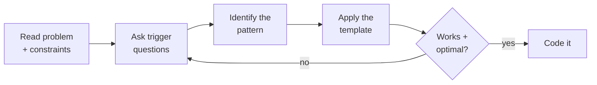
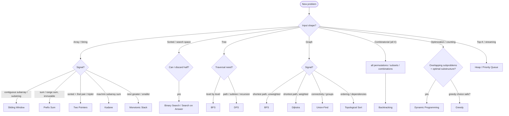
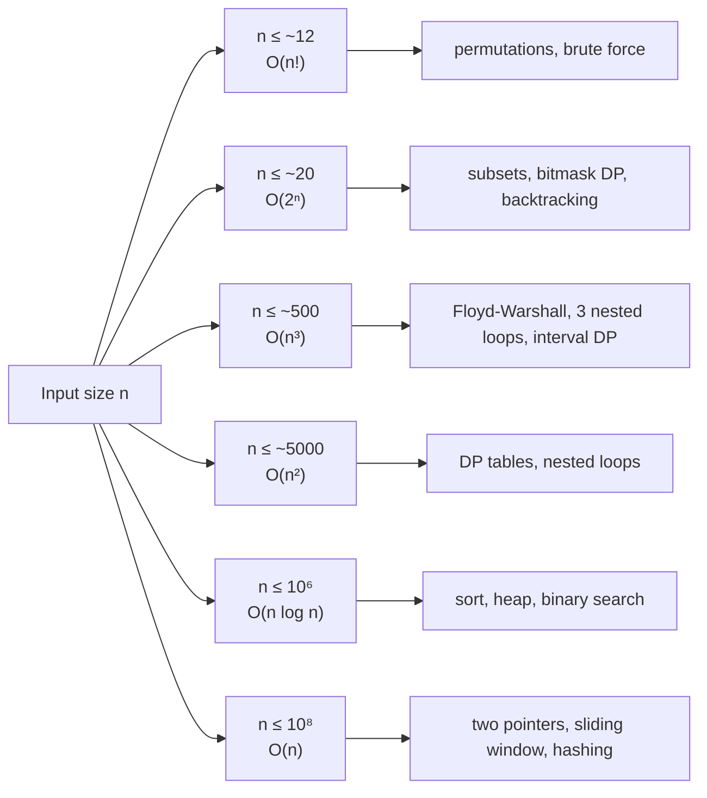
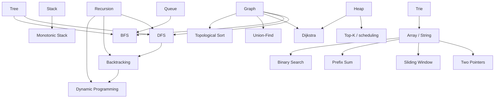
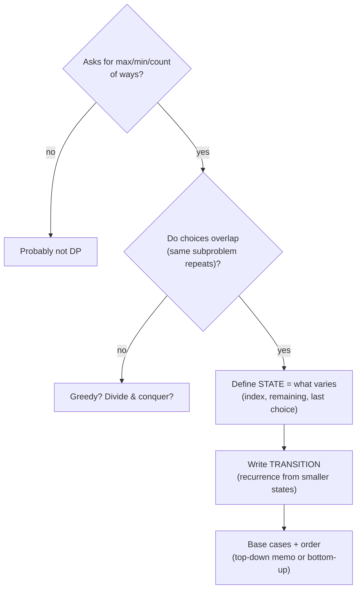
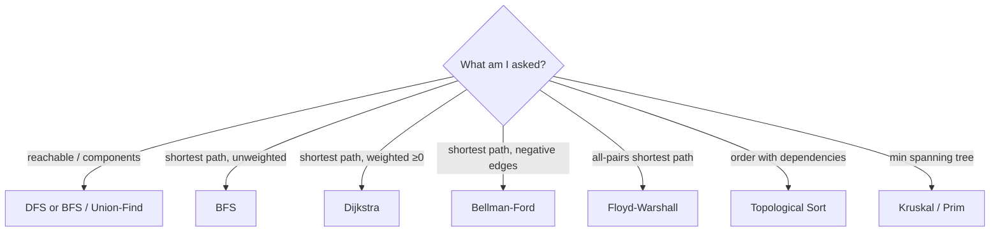
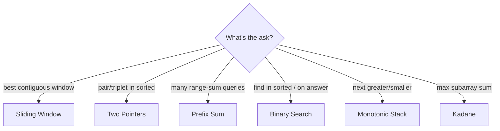

# 🧭 DSA Mental Models — How to *Think*

Most interview problems reuse a small set of patterns. The skill isn't memorizing solutions — it's
**recognizing which pattern a problem is asking for**. This page is the thinking layer: decision
flowcharts, trigger signals, and the mental web connecting structures to techniques.

Pair it with the [Quick Lookup](DSAQuickLookup.md) (keyword → pattern table) and the runnable
[Code Library](code-library/patterns.md).

!!! tip "The one habit that matters most"
    Before coding, spend 60 seconds on: **What's the input shape? What do the constraints imply?
    What's the target complexity?** Those three answers usually name the pattern for you.

---

## 1. The 4-step recognition loop

The framework every strong candidate runs, consciously or not
([source: LeetCode pattern-identification discussion](https://leetcode.com/discuss/post/7882581/how-to-identify-which-dsa-pattern-to-use-f33w/)):

The loop matters: if the first pattern doesn't fit the constraints, go back to the trigger
questions — don't force a template.

---

## 2. Master decision flowchart — "which pattern?"

Start from the **input shape**, then branch on the **signal words**. This covers the majority of
interview problems.

---

## 3. Signal → pattern (trigger questions)

When the flowchart isn't obvious, these phrase-level signals almost always point at one pattern:

| If the problem says… | Reach for | Why |
|----------------------|-----------|-----|
| "contiguous subarray/substring" + optimize | **Sliding Window** | one pass with a moving range |
| "sum over many ranges", array fixed | **Prefix Sum** | precompute cumulative sums |
| "sorted" + "pair/triplet summing to X" | **Two Pointers** | converge from both ends |
| "kth largest/smallest", "top K", "stream" | **Heap** | keep only K in order |
| "sorted" or "monotonic answer space" | **Binary Search** | discard half each step |
| "all permutations/subsets/combinations" | **Backtracking** | build incrementally, prune |
| "shortest path", unweighted grid/graph | **BFS** | explores by distance |
| "shortest path", weighted (non-negative) | **Dijkstra** | greedy by min distance |
| "are these connected / how many groups" | **Union-Find** | merge + find sets |
| "order tasks with dependencies" | **Topological Sort** | DAG ordering |
| "next greater/smaller element" | **Monotonic Stack** | maintain ordered stack |
| "max/min/count ways", overlapping states | **Dynamic Programming** | memoize subproblems |
| "min coins / max profit", local optimum works | **Greedy** | prove exchange argument |

Full keyword table: [DSAQuickLookup.md](DSAQuickLookup.md).

---

## 4. Constraints → target complexity

**The constraint size tells you the complexity you're allowed** — which narrows the pattern before
you even think about the approach. This is one of the highest-leverage interview habits.

| n up to | Allowed complexity | Typical techniques |
|---------|--------------------|--------------------|
| ~12 | O(n!) | permutations, brute force |
| ~20 | O(2ⁿ) | subsets, bitmask DP, backtracking |
| ~500 | O(n³) | Floyd-Warshall, interval DP |
| ~5,000 | O(n²) | DP tables, nested loops |
| ~10⁶ | O(n log n) | sorting, heap, binary search |
| ~10⁸ | O(n) or O(log n) | two pointers, sliding window, hashing |

*Numbers are rough (assume ~10⁸ simple ops/sec). The point is direction, not precision.*

---

## 5. The mental web — how it all connects

Patterns aren't isolated; they grow out of a few core structures and ideas. Seeing the web helps you
*derive* a pattern when you can't recall it.

Read it as "X is built from / leads to Y." For example: **backtracking is DFS with undo**, and **DP
is backtracking with memoization** — if you can write the brute-force recursion, you can usually
optimize it into DP.

---

## 6. Per-family mini decision trees

### Dynamic Programming — "is it DP, and what's the state?"

### Graph — "which traversal / algorithm?"

### Array / String — "which linear technique?"

---

## 7. Worked examples — the loop in action

Watch the recognition process, not just the answer. In each, the **signal** does the work.

!!! example "Longest substring without repeating characters"
    - **Shape/constraints:** a string; asks for the *longest contiguous* substring with a property.
    - **Signal:** "longest contiguous substring + a constraint" → this is the canonical
      **Sliding Window** cue.
    - **Why:** expand the window while valid, shrink from the left when a repeat appears — one pass,
      O(n). A brute-force check of all substrings would be O(n²).
    - **Pattern:** [Sliding Window](code-library/patterns.md).

!!! example "Kth largest element in a stream"
    - **Shape/constraints:** numbers arriving over time; need the Kth largest *at any point*.
    - **Signal:** "Kth largest" + "stream" → **Heap**. The "stream" word rules out sorting once.
    - **Why:** keep a **min-heap of size K**; the top is the Kth largest. Each insert is O(log K),
      far better than re-sorting O(n log n) each query.
    - **Pattern:** [Heap / Priority Queue](code-library/data-structures.md).

!!! example "Course schedule (can you finish all courses given prerequisites?)"
    - **Shape/constraints:** courses with dependency pairs → a **graph**; asks if a valid order
      exists.
    - **Signal:** "order with dependencies" / "detect if ordering possible" → **Topological Sort**
      (and cycle detection — a cycle means impossible).
    - **Why:** a DAG has a topological order; if you can't produce one (a cycle exists), you can't
      finish. Kahn's algorithm (BFS on in-degrees) or DFS with a visiting-state.
    - **Pattern:** [Topological Sort](code-library/algorithms.md).

!!! example "Coin change (fewest coins to make an amount)"
    - **Shape/constraints:** asks for the **minimum count of ways** to reach a target; the same
      sub-amounts recur across choices.
    - **Signal:** "min/max/count" + overlapping subproblems → **Dynamic Programming**. (A greedy
      "take the biggest coin" fails for arbitrary denominations — a classic trap.)
    - **Why:** `dp[amount] = 1 + min(dp[amount - coin])` over coins. Define state (remaining
      amount), transition (try each coin), base case (`dp[0]=0`).
    - **Pattern:** [Dynamic Programming](code-library/patterns.md).

!!! note "The meta-lesson"
    In all four, the **phrase** ("longest contiguous", "Kth in a stream", "dependencies", "min
    count") pointed at the pattern before any coding. Training that phrase→pattern reflex is the
    whole game — see the [signal table](#3-signal-pattern-trigger-questions).

---

## How to practice with this

1. For each new problem, **say the input shape and constraints out loud** before anything else.
2. Run the [4-step loop](#1-the-4-step-recognition-loop) — resist jumping straight to code.
3. When stuck, walk the [master flowchart](#2-master-decision-flowchart-which-pattern) and the
   [signal table](#3-signal-pattern-trigger-questions).
4. After solving, note *which signal* pointed at the pattern — that's what builds recognition.

## Related

- Keyword → pattern table → [DSAQuickLookup.md](DSAQuickLookup.md)
- Intuition + when-to-use per pattern → [DSACompleteGuide.md](DSACompleteGuide.md)
- Runnable implementations → [Code Library](code-library/patterns.md)
