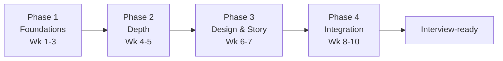

# 10-Week Interview Study Plan

A structured, **pattern-first** plan to get genuinely interview-ready for **entry-level to mid-level software engineering roles** at MAANG and
top Indian unicorns - not a grind list. It sequences the four things interviews actually grade:
**pattern recognition, system design, communication under pressure, and CS fundamentals.**

!!! quote "The single idea behind this plan"
    Interviews don't test how many problems you've *seen* - they test whether you can **recognize a
    pattern in an unfamiliar problem and articulate your thinking out loud under time pressure.**
    Everything below is built to train that, not to inflate a solved-count.

## Who this is for & the honest timeline

- **Target:** entry-level to mid-level software engineering roles at MAANG + Indian unicorns (Flipkart, Razorpay, CRED, Swiggy, Zomato, …).
- **Assumes:** you know one language well and have seen the patterns in the
  [DSA Complete Guide](../DSA/DSACompleteGuide.md). This plan *applies* patterns to interview
  problems - it is not where you learn recursion for the first time.
- **Time:** ~15-20 focused hours/week for 10 weeks (~180 hours total).

!!! warning "Read this before you start"
    Most strong candidates spend **3-6 months**. Ten weeks is realistic **only if you already have CS
    fundamentals and some pattern exposure**. If you're starting colder, stretch Phase 1 to 5-8 weeks
    rather than rushing - depth beats a finished checklist. This is a plan, not a guarantee; adjust
    the pace to your reality.

---

## The 4 phases at a glance

| Phase | Weeks | Focus | Primary outcome |
|-------|-------|-------|-----------------|
| **1. Foundations** | 1-3 | DSA patterns, breadth-first | Recognize + apply ~15 core patterns |
| **2. Depth** | 4-5 | DSA advanced + System Design starts | Handle Medium/Hard; run the SD framework |
| **3. Design & Story** | 6-7 | System Design deep + Behavioral | 6+ designs; a 12-15 story bank |
| **4. Integration** | 8-10 | Mock loops + company prep + polish | Perform end-to-end under real conditions |

---

## Deliberate-practice rules (apply from day one)

These rules are what separate "I solved 200 problems" from "I can solve a *new* problem." Follow them
on every single problem.

!!! tip "The 6 rules"
    1. **Timebox, then stop.** 30-40 min on a Medium. If stuck, read the *approach* (not the full
       solution), then re-solve from scratch.
    2. **Explain out loud while coding.** Interviews are verbal. If you can't narrate it, you don't
       own it.
    3. **Zero-assist reps.** No autocomplete, no AI, no peeking - at least for the first attempt.
    4. **Redo every failure.** A problem you needed help on goes into the **Retry Queue** (below) and
       is re-solved 2-3 days later, from blank.
    5. **Name the pattern.** After solving, write the one-line signal → pattern (see
       [DSA Mental Models](../DSA/mental-models.md)). That reflex is what gets graded.
    6. **Whiteboard/paper reps weekly.** Coding without an IDE is a different skill; rehearse it.

### The Retry Queue (spaced repetition - the highest-leverage habit)

Most people re-solve what they already know and skip what they failed. Invert that.

- [ ] Keep a simple list (spreadsheet/Notion): **problem · date failed · retry date (+2-3 days) · retry date (+1 week)**
- [ ] Any problem you couldn't solve unaided goes in immediately.
- [ ] Re-solve **from blank** on the retry date. If you fail again, push the date out and add a note on *why* (wrong pattern? edge case? implementation?).
- [ ] A problem leaves the queue only after **two clean, unaided solves**.

!!! example "Why this works"
    Re-solving a problem you *failed*, days later, from scratch, is the exact retrieval-under-difficulty
    that builds durable recall. Re-reading solutions feels productive and builds almost nothing.

---

## Weekly overview

| Week | Phase | DSA | System Design | Behavioral | CS Fund + Q&A | Mock |
|------|-------|-----|---------------|------------|---------------|------|
| 1 | Foundations | Arrays, strings, two-pointer, sliding window (~18) | - | - | OS + concurrency notes | - |
| 2 | Foundations | Hashing, stacks, linked lists, binary search (~18) | - | 2 stories | networking + hashing notes | - |
| 3 | Foundations | Trees, BFS/DFS, heaps (~18) | Read the SD framework | 2 stories | DB internals + caching | self-explain |
| 4 | Depth | Graphs, backtracking (~14) | Framework + 2 designs | 2 stories | SQL practice set | **Mock #1 (DSA)** |
| 5 | Depth | DP (~14) | 2 designs + components | 2 stories | security + OOP notes | **Mock #2 (DSA)** |
| 6 | Design & Story | Mixed Medium/Hard (~10) | 3 designs (deep) | Story bank to 8 | estimation + rapid-fire | **Mock #3 (SD)** |
| 7 | Design & Story | Retry Queue + weak topics | 3 designs + trade-offs | Story bank to 12-15 | memory/runtime + Q&A | **Mock #4 (Behavioral)** |
| 8 | Integration | Company-tagged (~10) | Timed 45-min designs | Polish + record | weak-cluster Q&A | **Mock #5 (full loop)** |
| 9 | Integration | Company-tagged + Retry Queue | Timed designs | Company "why us" | rapid-fire daily | **Mock #6 (full loop)** |
| 10 | Polish | Light review only | 1-2 fresh designs | Final rehearsal | rapid-fire | **Mock #7 (simulation)** |

*Problem counts are targets (~130-140 total), not quotas. Depth on each beats rushing to the number.*

---

## Phase 1 - Foundations (Weeks 1-3)

**Goal:** breadth across the core patterns so nothing in an interview is *unfamiliar*. Volume is
secondary to naming the pattern behind each problem.

=== "Week 1 - Arrays / Strings / Windows"

    **DSA (~18 problems)** - reference: [Two Pointers](../DSA/code-library/patterns.md), [Sliding Window](../DSA/DSAQuickLookup.md)

    - [ ] Two Sum · Best Time to Buy/Sell Stock · Contains Duplicate *(Easy warm-ups)*
    - [ ] Product of Array Except Self · Maximum Subarray (Kadane) · 3Sum
    - [ ] Longest Substring Without Repeating Characters · Group Anagrams
    - [ ] Container With Most Water · Trapping Rain Water *(Hard)*
    - [ ] Subarray Sum Equals K · Longest Consecutive Sequence
    - [ ] Minimum Window Substring *(Hard)* · Sliding Window Maximum *(Hard)*
    - [ ] +4-5 more from the same patterns on your weakest area

    **CS Fundamentals**

    - [ ] [Operating Systems](../Fundamentals/operating-systems.md) + [Concurrency](../Fundamentals/concurrency-and-parallelism.md) notes; drill [Operating Systems Q&A](../QA-Bank/qa-operating-systems.md) + [Concurrency Q&A](../QA-Bank/qa-concurrency.md)

=== "Week 2 - Hashing / Stacks / Lists / Search"

    **DSA (~18 problems)**

    - [ ] Valid Parentheses · Min Stack · Daily Temperatures · Evaluate RPN
    - [ ] Next Greater Element · Largest Rectangle in Histogram *(Hard)*
    - [ ] Reverse Linked List · Merge Two Sorted Lists · Linked List Cycle
    - [ ] Reorder List · Merge K Sorted Lists *(Hard)*
    - [ ] Binary Search · Search in Rotated Sorted Array · Find Minimum in Rotated Array
    - [ ] Koko Eating Bananas / "search on answer" · +3-4 more

    **Behavioral**

    - [ ] Read the [Behavioral Guide](../Behavioral/BehavioralGuide.md); write **2 STAR stories** (1 leadership, 1 conflict)

    **CS Fundamentals**

    - [ ] [Networking](../Fundamentals/networking.md) + [Hashing](../Fundamentals/hashing.md) notes + matching Q&A

=== "Week 3 - Trees / Traversals / Heaps"

    **DSA (~18 problems)**

    - [ ] Max Depth · Same Tree · Invert Tree · Level Order Traversal
    - [ ] Validate BST · LCA of BST · Kth Smallest in BST
    - [ ] Binary Tree Max Path Sum *(Hard)* · Serialize/Deserialize Tree *(Hard)*
    - [ ] Kth Largest Element · Top K Frequent · Find Median from Data Stream *(Hard)*
    - [ ] Task Scheduler · +4-5 more

    **System Design (start light)**

    - [ ] Read the [System Design Guide](../SystemDesign/SystemDesignGuide.md) + [SD Mental Models](../SystemDesign/mental-models.md)

    **Behavioral**

    - [ ] Write **2 more stories** (1 failure, 1 impact)

    **CS Fundamentals**

    - [ ] [Database Internals](../Fundamentals/databases-internals.md) + [Caching](../SystemDesign/components/caching.md)

!!! success "On-track signal for Phase 1"
    Given a new Easy/Medium, within ~30 seconds you can say **"this is a sliding-window / two-pointer /
    BFS problem because…"** - even if you haven't coded it yet. If you can't name patterns yet, spend
    another week here before advancing.

---

## Phase 2 - Depth (Weeks 4-5)

**Goal:** the patterns people find hard (graphs, backtracking, DP) and the first real system-design
reps. Mock loops start now - not at the end.

=== "Week 4 - Graphs + Backtracking + SD framework"

    **DSA (~14 problems)**

    - [ ] Number of Islands · Clone Graph · Course Schedule I & II *(topo sort)*
    - [ ] Pacific Atlantic Water Flow · Number of Connected Components
    - [ ] Word Ladder *(Hard)* · Alien Dictionary *(Hard)* · Network Delay Time *(Dijkstra)*
    - [ ] Permutations · Subsets · Combination Sum · N-Queens *(Hard)* · Word Search

    **System Design**

    - [ ] Run the framework on [URL Shortener](../SystemDesign/designs/url-shortener.md) end-to-end (requirements → estimation → API → HLD → deep dive)
    - [ ] Study [Rate Limiter](../SystemDesign/designs/rate-limiter.md)

    **Behavioral:** 2 stories (innovation, pressure). &nbsp; **CS:** [SQL practice set](../Databases/query-practice-set.md).

    - [ ] :material-account-group: **Mock #1 - DSA** (Pramp / a peer). Get used to explaining out loud.

=== "Week 5 - Dynamic Programming"

    **DSA (~14 problems)** - reference: [DP Patterns](../DSA/code-library/patterns.md)

    - [ ] Climbing Stairs · House Robber · Coin Change · Longest Increasing Subsequence
    - [ ] Longest Common Subsequence · Word Break · Unique Paths · Jump Game
    - [ ] Partition Equal Subset Sum · Edit Distance *(Hard)*
    - [ ] Regular Expression Matching *(Hard)* · Burst Balloons *(Hard)* · +2 more

    **System Design**

    - [ ] Study [Key-Value Store](../SystemDesign/designs/key-value-store.md) + [Notification System](../SystemDesign/designs/notification-system.md)
    - [ ] Components: [Load Balancer](../SystemDesign/components/load-balancer.md), [Sharding](../SystemDesign/components/database-sharding.md)

    **Behavioral:** 2 stories (customer focus, ownership). &nbsp; **CS:** [Security](../Fundamentals/security-fundamentals.md) + [OOP](../Fundamentals/oop-and-language-concepts.md).

    - [ ] :material-account-group: **Mock #2 - DSA** (trees/graphs/DP focus).

!!! success "On-track signal for Phase 2"
    You can solve a **new Medium unaided in ~25-30 min while narrating**, and you can walk the
    [SD framework](../SystemDesign/mental-models.md) on a familiar system without notes.

---

## Phase 3 - Design & Story (Weeks 6-7)

**Goal:** system design at interview depth, and a behavioral story bank that actually covers the
question space. DSA shifts to **maintenance via the Retry Queue**, not new volume.

=== "Week 6 - System Design deep dive"

    **System Design (3 designs, full 45-min depth each)**

    - [ ] [Twitter / News Feed](../SystemDesign/designs/twitter.md) - fan-out on write vs read (the pivotal trade-off)
    - [ ] [Instagram](../SystemDesign/designs/instagram.md) - media storage + CDN + feed
    - [ ] [Web Crawler](../SystemDesign/designs/web-crawler.md) - frontier, politeness, dedup

    **DSA:** ~10 mixed Medium/Hard + clear the Retry Queue. &nbsp; **CS:** [Estimation](../Fundamentals/latency-numbers-and-estimation.md) + [rapid-fire](../QA-Bank/qa-rapid-fire.md).

    **Behavioral:** grow the story bank to **8** (see [STAR template](../Behavioral/STAR-stories.md)).

    - [ ] :material-account-group: **Mock #3 - System Design** (peer or [interviewing.io](https://interviewing.io)).

=== "Week 7 - Trade-offs + Story bank"

    **System Design (3 more + trade-off drills)**

    - [ ] [Distributed Cache](../SystemDesign/designs/distributed-cache.md) · [Unique ID Generator](../SystemDesign/designs/unique-id-generator.md) · [Search Autocomplete](../SystemDesign/designs/search-autocomplete.md)
    - [ ] For each, practice defending **one or two pivotal trade-offs** out loud

    **Behavioral (the big push)**

    - [ ] Finish the bank at **12-15 stories**, each tagged to 2-3 themes/[Amazon LPs](../Behavioral/leadership-principles.md)
    - [ ] Nail "Tell me about yourself" (2 min) and "Tell me about a failure" (3 min)

    **DSA:** Retry Queue + 2 weakest topics. &nbsp; **CS:** [Memory & Runtime](../Fundamentals/memory-and-runtime.md).

    - [ ] :material-account-group: **Mock #4 - Behavioral** (record yourself; watch for filler words, rambling, no metrics).

!!! success "On-track signal for Phase 3"
    You can design a familiar system in **45 minutes on a blank whiteboard** and articulate the key
    trade-off, and you have **12-15 stories** you can tell in under 3 minutes each without notes.

---

## Phase 4 - Integration (Weeks 8-10)

**Goal:** perform under real conditions. This phase is mostly **mock loops + targeted company prep +
Retry Queue** - very little new material.

### Weekly mock loop (the core of this phase)

Run this every week in Phase 4. Mocks are the closest proxy to the real thing and expose exactly
what to fix.

| Cadence | Session | Where |
|---------|---------|-------|
| 2× / week | DSA mock (45 min, explain aloud) | [Pramp](https://www.pramp.com), peer |
| 1× / week | System design mock (45 min) | peer / [interviewing.io](https://interviewing.io) |
| 1× / week | Behavioral mock (record it) | peer / friend |
| End of week | **Full loop** (DSA + SD + behavioral back-to-back) | simulate a real on-site |

=== "Week 8 - Company-tagged + full loop"

    - [ ] Pick your **top 2 target companies**; solve their tagged problems (LeetCode premium)
    - [ ] 2 timed 45-min system designs (pick unseen prompts)
    - [ ] Record 3 behavioral answers; cut filler and tighten to time
    - [ ] :material-account-group: **Mock #5 - full loop**

=== "Week 9 - Sharpen + company fit"

    - [ ] More company-tagged problems + clear the Retry Queue to empty
    - [ ] Prepare **"why this company"** + 5 questions to ask (see [Questions to Ask](../Behavioral/QuestionsToAsk.md))
    - [ ] Review [company-specific behavioral](../Behavioral/company-specific/amazon.md) for your targets
    - [ ] :material-account-group: **Mock #6 - full loop**

=== "Week 10 - Taper + simulate"

    - [ ] **Reduce volume.** Light review only - you're sharpening, not cramming.
    - [ ] 1-2 fresh system designs to stay warm; re-read your story bank once
    - [ ] [rapid-fire](../QA-Bank/qa-rapid-fire.md) the morning of interviews
    - [ ] Normalize sleep; no late-night grinding before an interview
    - [ ] :material-account-group: **Mock #7 - full simulation** under real timing

!!! success "On-track signal for Phase 4 (interview-ready)"
    In mocks you **consistently** finish a Medium in time while talking, complete a system design in
    45 min with a clear trade-off, and tell any story crisply. Nerves aside, nothing in the format
    surprises you anymore.

---

## Company-specific emphasis

Tune the last weeks to your targets. Depth on the company's known emphasis beats generic breadth.

=== "Google"

    - Heavier on **algorithms, DP, graphs, string manipulation**; expect follow-ups that push
      optimality.
    - "Googleyness" behavioral - humility + owning your part. See [Google guide](../Behavioral/company-specific/google.md).

=== "Meta"

    - **Breadth + speed** - many Mediums fast; trees, BFS/DFS, arrays. Product-sense flavor in design.
    - See [Meta guide](../Behavioral/company-specific/meta.md).

=== "Amazon"

    - **DP, greedy, OOP/LLD**, and behavioral is *heavily* weighted on the **16 Leadership Principles**
      - 12-15 stories mapped to LPs is non-negotiable. See [Amazon guide](../Behavioral/company-specific/amazon.md) + [LPs](../Behavioral/leadership-principles.md).

=== "Microsoft / Apple"

    - Trees, recursion, backtracking; cleaner-code emphasis; calmer behavioral. See
      [Microsoft](../Behavioral/company-specific/microsoft.md) · [Apple](../Behavioral/company-specific/apple.md).

=== "Indian unicorns"

    - Flipkart/Razorpay/CRED/Swiggy/Zomato: strong DSA + practical system design + culture fit. See
      [Indian startups guide](../Behavioral/company-specific/indian-startups.md) + [India-specific](../InterviewPrep/India-Specific.md).

---

## Progress tracker

**DSA (~130-140 problems, pattern-first)**

- [ ] Phase 1: ~54 breadth problems across core patterns
- [ ] Phase 2: ~28 graphs / backtracking / DP
- [ ] Phase 3: ~10 mixed + Retry Queue maintenance
- [ ] Phase 4: ~20 company-tagged + Retry Queue to empty
- [ ] **Retry Queue emptied** (every failure re-solved twice, unaided)

**System Design (8+ designs at 45-min depth)**

- [ ] Framework internalized ([SD Mental Models](../SystemDesign/mental-models.md))
- [ ] 6 designs studied + re-designed from blank
- [ ] 2+ unseen prompts done under timer

**Behavioral (12-15 stories)**

- [ ] Story bank complete, each tagged to 2-3 themes/LPs
- [ ] "Tell me about yourself" + "failure" + "conflict" rehearsed to time
- [ ] Recorded yourself at least 3× and cut the filler

**CS Fundamentals + Q&A**

- [ ] All [core] [Fundamentals](../Fundamentals/README.md) notes read; fluent 2-min answers
- [ ] [Q&A Bank](../QA-Bank/README.md) drilled; [rapid-fire](../QA-Bank/qa-rapid-fire.md) sharp

**Mocks**

- [ ] 7+ mocks done, including 3 full loops

---

## Common failure modes (and the fix)

| Failure mode | Fix |
|--------------|-----|
| Solved 300 problems, still freeze on new ones | You memorized, didn't pattern-recognize. Use [Mental Models](../DSA/mental-models.md) + name the signal every time. |
| Silent while coding | Practice narrating from Phase 1. Interviews are 50% communication. |
| Re-reading solutions, feeling "productive" | Replace with the Retry Queue - re-solve from blank. |
| Skipping system design till the end | It needs weeks to internalize. Start Phase 1 reading, design from Week 4. |
| Behavioral as an afterthought | For Amazon it's ~half the loop. Build the story bank by Week 7. |
| Cramming the last week | Taper in Week 10. Rest compounds; cramming doesn't. |

---

## Adjusting the timeline

- **Have only 6 weeks?** Do Phase 1 (compressed to 2 wk), Phase 2, and Phase 4. Drop the second half
  of system design and trim to ~90 problems. Keep the Retry Queue and mocks - they're the highest ROI.
- **Have 4+ months?** Stretch Phase 1 to build genuine fundamentals, add advanced structures
  (segment/Fenwick trees, advanced DP), and do more system-design breadth. Don't just add problem
  volume - add mock reps and depth.

---

## Resources

- **DSA:** [Complete Guide](../DSA/DSACompleteGuide.md) · [Quick Lookup](../DSA/DSAQuickLookup.md) · [Mental Models](../DSA/mental-models.md) · [Code Library](../DSA/code-library/patterns.md) · [NeetCode 150](https://neetcode.io)
- **System Design:** [Guide](../SystemDesign/SystemDesignGuide.md) · [Mental Models](../SystemDesign/mental-models.md) · [Designs](../SystemDesign/designs/url-shortener.md) · [System Design Primer](https://github.com/donnemartin/system-design-primer)
- **Behavioral:** [Guide](../Behavioral/BehavioralGuide.md) · [STAR Template](../Behavioral/STAR-stories.md) · [Company Guides](../Behavioral/company-specific/amazon.md)
- **Fundamentals & Q&A:** [Fundamentals](../Fundamentals/README.md) · [Q&A Bank](../QA-Bank/README.md) · [Databases](../Databases/README.md)
- **Mocks:** [Pramp](https://www.pramp.com) (free peer) · [interviewing.io](https://interviewing.io) (real engineers)

---

!!! quote "Three things to remember"
    **Consistency > intensity** - 2-3 focused hours daily beats a 12-hour weekend binge. &nbsp;
    **Recognition > recall** - name patterns, don't memorize solutions. &nbsp;
    **Reps under pressure > silent solving** - mocks and out-loud practice are what transfer to the room.

*Last reviewed: 2026. This is a structured plan, not a guarantee - calibrate to your starting point and targets.*
