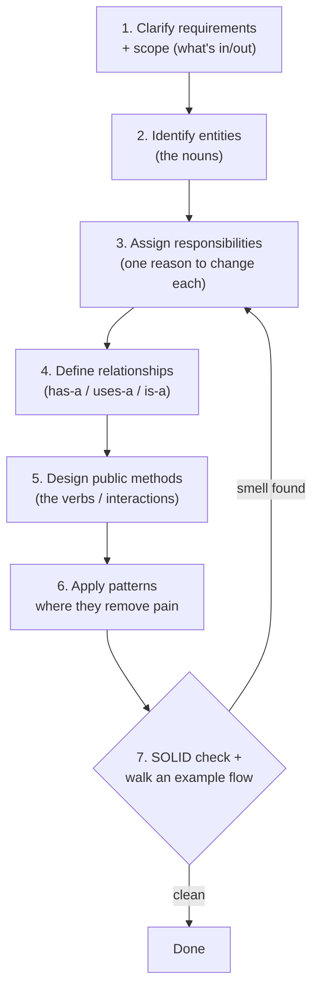
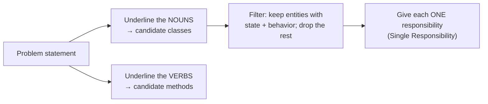
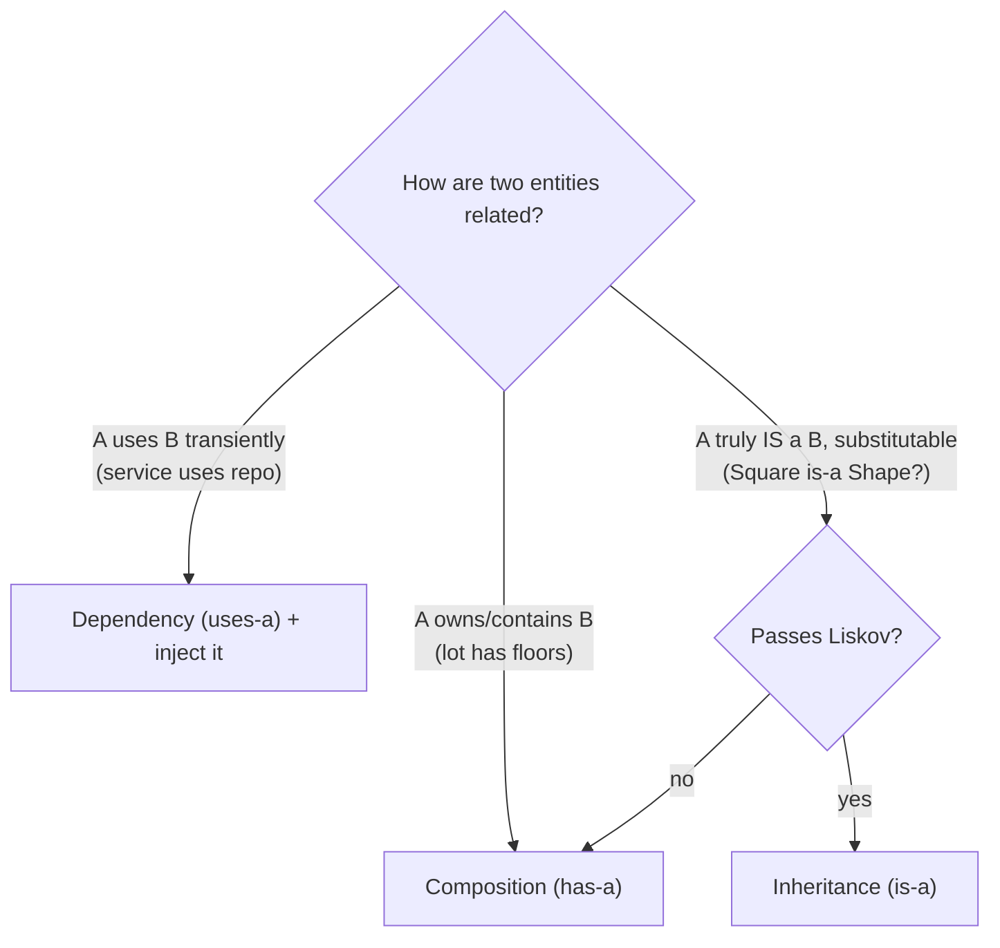
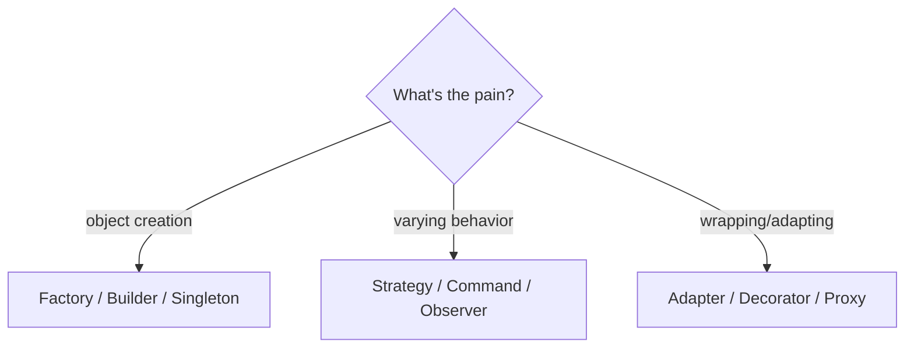
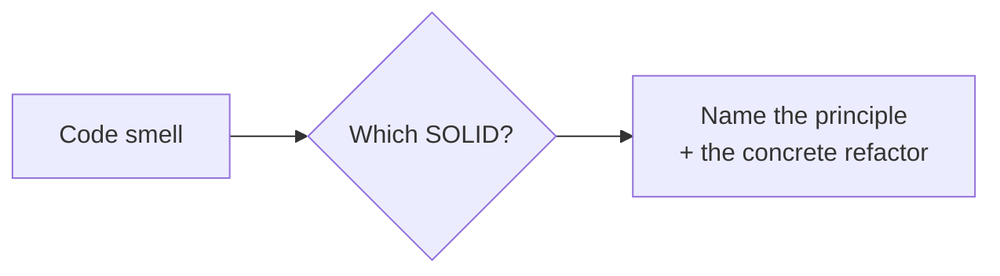
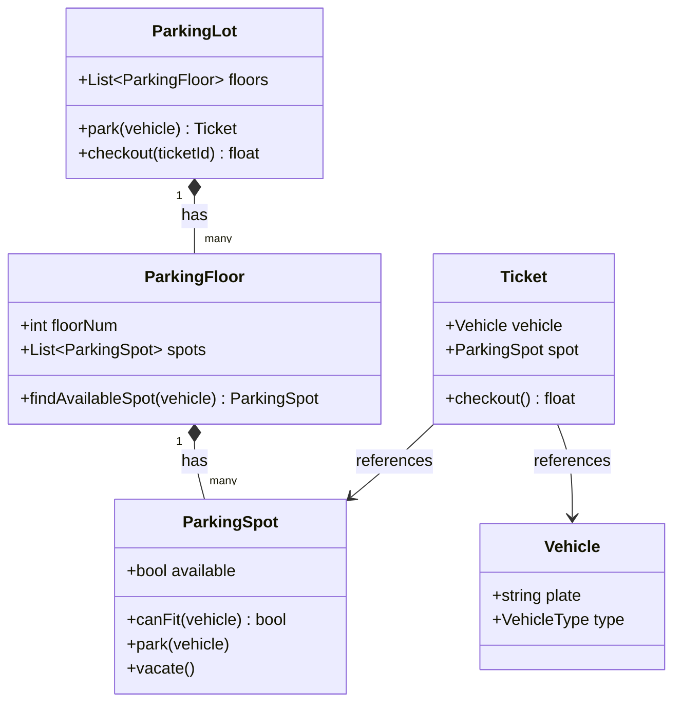

# 🧭 Low-Level Design Mental Models - How to *Model*

LLD (a.k.a. object-oriented design) rounds ask you to turn a fuzzy problem ("design a parking lot")
into clean classes with the right responsibilities and relationships. The skill is a **repeatable
modeling process** plus knowing **which pattern** fits a given need. This is the thinking layer.

Pair it with the [LLD Roadmap](roadmap.md) (patterns + SOLID in depth) and the OOP concepts in
[Fundamentals](../Fundamentals/oop-and-language-concepts.md).

!!! tip "The core move"
    **Nouns become classes, verbs become methods, and "has-a" beats "is-a".** Find the entities,
    give each one responsibility, connect them by composition, and apply a pattern only where it
    removes real pain - not for its own sake.

---

## 1. The LLD approach - run this every time

Loop back on a smell - a fat class or a rigid hierarchy means step 3 or 4 needs rework.

---

## 2. Identify entities → responsibilities

The mechanical starting move interviewers expect:

Example ("parking lot"): nouns → `ParkingLot`, `ParkingFloor`, `ParkingSpot`, `Vehicle`,
`Ticket` → each becomes a class with a focused job.

---

## 3. Relationships - composition over inheritance

Default to **composition**; reach for inheritance only for a genuine, substitutable "is-a". The
classic trap (a subtype that can't honor the parent's contract breaks Liskov) is why - see the
LSP example in the [Roadmap](roadmap.md#4-solid-principles).

---

## 4. Which design pattern?

Patterns solve recurring problems. Match the *need*, don't force a pattern:

| If you need to… | Pattern |
|-----------------|---------|
| create objects without hardcoding the concrete class | **Factory** |
| swap an algorithm/behavior at runtime | **Strategy** |
| notify many objects when one changes | **Observer** (pub/sub) |
| add behavior to an object without subclassing | **Decorator** |
| one shared instance (config, connection pool) | **Singleton** (use sparingly) |
| make an incompatible interface work | **Adapter** |
| control access / add caching around an object | **Proxy** |
| encapsulate an action as an object (undo/redo, queues) | **Command** |
| build a complex object step by step | **Builder** |

Full Java examples of each: [Roadmap → Design Patterns](roadmap.md#6-design-patterns) and
[Extended Patterns](patterns-extended.md).

---

## 5. SOLID - spot the smell, name the fix

Interviewers love "what's wrong with this class?" Map the smell to the principle and the fix:

| Smell | Violates | Fix |
|-------|----------|-----|
| One class does DB + email + business logic | **S**RP | split into focused classes |
| Adding a new type means editing a big `if/else` | **O**CP | polymorphism / Strategy |
| Subclass breaks the parent's contract (Square/Rectangle) | **L**SP | rethink the hierarchy; compose |
| One fat interface forces unused methods | **I**SP | split into small interfaces |
| High-level code `new`s concrete low-level classes | **D**IP | depend on an interface; inject it |

Being able to *name the principle and the refactor* is what scores - see the SOLID examples in the
[Roadmap](roadmap.md#4-solid-principles).

---

## 6. Worked example - parking lot class diagram

Applying steps 1-5: entities become classes, the lot **composes** floors and spots, and a `Ticket`
links a vehicle to a spot.

- `*--` = **composition** (the lot owns its floors; floors own their spots).
- `-->` = **association** (a ticket references a vehicle and a spot, but doesn't own them).

Full implementation (with the fee calculation and dispatch): [Worked Problems → Parking Lot](worked-problems.md#problem-1-parking-lot).

---

## How to practice with this

1. For any LLD prompt, **list nouns and verbs first** - resist jumping to code.
2. Run the [approach flowchart](#1-the-lld-approach-run-this-every-time); assign each class *one*
   responsibility.
3. Default to **composition**; justify any inheritance with Liskov.
4. Add a pattern only when you can name the pain it removes.
5. Sanity-check against **SOLID** and walk one concrete flow (e.g. "a car parks, then leaves").

## Related

- Patterns, SOLID, fundamentals in depth → [Roadmap](roadmap.md)
- Full solved problems → [Worked Problems](worked-problems.md)
- OOP pillars, SOLID, composition vs inheritance → [Fundamentals](../Fundamentals/oop-and-language-concepts.md)
- OOP & design Q&A → [QA-Bank](../QA-Bank/qa-oop-design.md)
- System-level thinking → [System Design Mental Models](../SystemDesign/mental-models.md)
