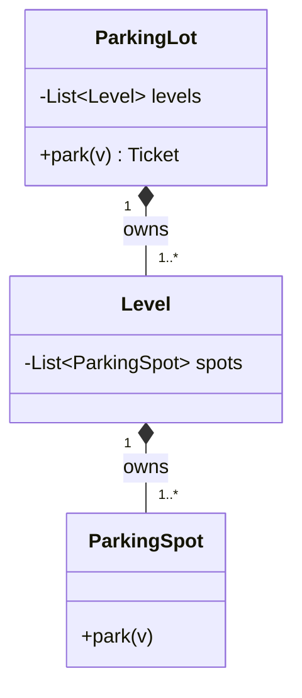
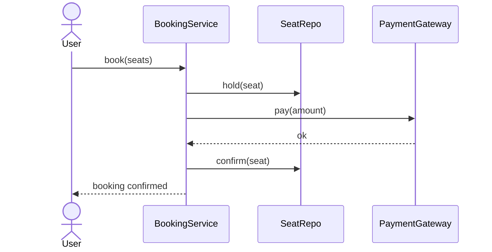

# LLD Roadmap - Fundamentals in Depth

The [overview](lld-overview.md) lists an 8-step learning roadmap; this page explains each step in
depth with examples and trade-offs.

!!! note "Language"
    Examples are in **Java** - that's where most LLD interviews happen, so the idioms that matter
    (interfaces, abstract classes, access modifiers, `static`/`final`) are shown directly. The Java
    is deliberately kept simple and interview-minimal. For Java syntax as a standalone reference, see
    the [Java Cheat Sheet](java-cheatsheet.md).

!!! tip "Canonical code reference"
    This page teaches the *concepts and trade-offs*. For a compact, runnable set of SOLID + GoF
    pattern examples in one place, see the [Low-Level Design Guide](LowLevelDesign.md). OOP pillars
    at the fundamentals level live in
    [Fundamentals → OOP & Language](../Fundamentals/oop-and-language-concepts.md).

## Roadmap at a glance

1. [OOP basics](#1-oop-basics) - class, object, constructor, `static`, `final`, overloading vs overriding
2. [Four pillars](#2-four-pillars-of-oop) - encapsulation, abstraction, inheritance, polymorphism
3. [Relationships](#3-relationships) - association, aggregation, composition
4. [SOLID](#4-solid-principles) - the five design principles
5. [Interface vs abstract](#5-interface-vs-abstract-class) - when to use which
6. [Design patterns](#6-design-patterns) - creational, structural, behavioral
7. [UML](#7-uml-basics) - class & sequence diagrams
8. [Practice](#8-practice-mocks) - how to actually get good

---

# 1. OOP basics

The vocabulary everything else is built on. In an LLD round you won't be *asked* "what is a
constructor" - but you use all of this constantly, so it must be automatic.

## Class vs object

- **Class** = a blueprint / template. Defines what fields (state) and methods (behavior) a
  thing has.
- **Object** = a concrete instance of a class, with its own copy of the state.

One class → many objects. `Vehicle` is the class; *your specific car* is an object.

```java
public class Vehicle {
    private String plate;        // state
    private int wheels;

    public Vehicle(String plate, int wheels) {  // constructor
        this.plate = plate;
        this.wheels = wheels;
    }

    public String describe() {   // behavior
        return plate + " has " + wheels + " wheels";
    }
}

Vehicle car = new Vehicle("KA01AB1234", 4);   // object / instance ('new' creates it)
Vehicle bike = new Vehicle("KA02CD5678", 2);  // a different object
System.out.println(car.describe());           // KA01AB1234 has 4 wheels
```

## Constructor

Special method that runs when an object is created; it initializes state.

In **Java** a constructor is a method with the class's name and no return type. You can have
**multiple constructors** (constructor overloading) with different parameter lists, and one can
delegate to another with `this(...)`.

```java
public class Booking {
    private String user;
    private List<String> seats;
    private double discount;

    public Booking(String user, List<String> seats) {   // constructor 1
        this(user, seats, 0.0);                          // delegates to constructor 2
    }
    public Booking(String user, List<String> seats, double discount) {  // constructor 2
        this.user = user;
        this.seats = seats;
        this.discount = discount;
    }
}
```

## `static` vs instance

- **Instance member** - belongs to each object; each object has its own copy.
- **Static member** - belongs to the **class itself**, shared by all objects. Used for
  constants, counters, factory methods, and utility functions that don't need object state.

```java
public class ParkingLot {
    public static final int MAX_LEVELS = 10;   // 'static final' = shared constant
    private static int count = 0;              // shared across all instances
    private String name;

    public ParkingLot(String name) {
        this.name = name;
        count++;
    }

    public static boolean isValidPlate(String plate) {  // call as ParkingLot.isValidPlate(...)
        return plate.length() == 10;
    }
}
```

**Interview relevance:** Singleton (one DB instance), constants, and ID generators all lean
on `static`.

## `final` (Java) / constants & immutability (Python)

`final` in Java means "cannot change after assignment":

- `final` variable → a constant (can't reassign)
- `final` method → can't be overridden by a subclass
- `final` class → can't be extended (e.g. `String`)

(For contrast: Python has no true `final` - it relies on `UPPER_CASE` naming conventions and
type-checker hints rather than compiler enforcement.) In Java, a `final` field plus no setter
gives you an immutable object:

```java
public final class Point {          // final class: cannot be subclassed
    private final int x;             // final field: set once in constructor
    private final int y;
    public Point(int x, int y) { this.x = x; this.y = y; }
    public int getX() { return x; }  // no setter -> immutable
}
```

## Overloading vs overriding (classic interview trap)

| | **Overloading** | **Overriding** |
|---|---|---|
| What | Same method name, **different parameters**, in the **same class** | Subclass **redefines** a method it inherited (same name + params) |
| Resolved at | **Compile time** (static polymorphism) | **Runtime** (dynamic polymorphism) |
| Relationship | No inheritance needed | Requires inheritance |
| Python support | **Not native** - last definition wins; simulate with default args / `*args` / `functools.singledispatch` | Fully supported - just redefine the method |

Note: Java supports overloading natively (two real methods chosen by argument types at compile
time); Python does not - a later `def` with the same name just replaces the earlier one, so you
simulate it with default args or `*args`.

```java
// OVERLOADING - two real methods, chosen at compile time by argument types
class Calc {
    int add(int a, int b)        { return a + b; }
    int add(int a, int b, int c) { return a + b + c; }   // same name, different params
}

// OVERRIDING - @Override annotation, resolved at runtime
class Vehicle { int fare() { return 10; } }
class Bike extends Vehicle {
    @Override int fare() { return 5; }
}
```

---

# 2. Four pillars of OOP

Don't memorize definitions - understand *why* each exists and the boundary it sets.

## Encapsulation - bundle state + behavior, hide the internals

Keep data and the methods that operate on it in one class, and expose **only** a controlled
interface. The outside world touches your object through methods, not by poking fields
directly. This lets you change internals without breaking callers and enforce invariants
(validation).

```java
public class BankAccount {
    private double balance;               // truly private - compiler enforced

    public void deposit(double amount) {
        if (amount <= 0) throw new IllegalArgumentException("positive only");
        this.balance += amount;           // invariant enforced here
    }
    public double getBalance() { return balance; }   // getter; no setter = read-only
}
```

**Java** enforces encapsulation with `private` / `public` / `protected` plus getters/setters -
the compiler stops outside code from touching a `private` field directly. (Python has no hard
private; it relies on `_x`/`__x` naming conventions instead.)

> Interview tie-in: encapsulation is *how* you achieve SRP and loose coupling in practice.

## Abstraction - expose *what*, hide *how*

Show the user a simple set of operations and hide the complex implementation. The user
interacts with the **right methods** only and doesn't need to know the internal mechanism.

Encapsulation vs abstraction (they're related, not the same):

- **Abstraction** = design-level: *what* operations exist (the contract).
- **Encapsulation** = implementation-level: *hiding* the data/mechanism behind that contract.

```java
public interface PaymentGateway {    // abstraction: defines WHAT, not HOW
    boolean pay(double amount);
}
public class RazorpayGateway implements PaymentGateway {
    public boolean pay(double amount) { /* talk to Razorpay API - hidden impl */ return true; }
}

void checkout(PaymentGateway gateway, double amount) {
    gateway.pay(amount);             // caller only knows the abstraction
}
```

## Inheritance - reuse via an "is-a" relationship

A subclass inherits fields/methods from a parent and can add or override behavior. Use it
when the child genuinely **is a** kind of the parent.

⚠️ **Prefer composition over inheritance** (very common LLD advice). Deep inheritance trees
are rigid; "has-a" composition is more flexible. Use inheritance for true is-a, not just to
reuse code.

```java
class Vehicle {
    protected String plate;
    String start() { return "engine on"; }
}
class Car extends Vehicle {       // 'extends' = inheritance; Car IS-A Vehicle
    @Override String start() { return "car " + super.start(); }  // override
    String openTrunk() { return "trunk open"; }                  // extra behavior
}
```

**Java** has single class inheritance (one `extends`) but a class can implement **multiple
interfaces**. (Python allows multiple inheritance with an MRO - method resolution order - which
Java deliberately avoids.)

### Trade-off: composition vs inheritance

| | **Inheritance** ("is-a") | **Composition** ("has-a") |
|---|---|---|
| Coupling | **Tight** - subclass depends on parent internals; a parent change can break children | **Loose** - the whole only uses the part's public API |
| Flexibility | Fixed at compile time; one parent (Java) | Swap/add behavior at runtime; combine many parts |
| Reuse | Reuse by extending | Reuse by delegating to held objects |
| Risk | Fragile base class, deep brittle hierarchies, LSP violations | More wiring/boilerplate, one extra layer of indirection |
| Best when | A true, stable is-a with shared state + behavior | Behavior varies, or you'd otherwise explode subclasses |

**The classic cost of over-inheritance** - a "class explosion": modelling `ElectricCar`,
`DieselCar`, `ElectricTruck`, `DieselTruck`... as subclasses multiplies combinatorially.
Composition (a `Car` *has* an `Engine`) collapses it to `Car(ElectricEngine())`.

> Rule of thumb: reach for inheritance only when the is-a is genuine *and* stable. If you're
> inheriting just to reuse code, that's a smell - delegate to a held object instead. Nearly
> every GoF pattern (Strategy, Decorator, Adapter) is "favor composition" in disguise.

## Polymorphism - one interface, many forms

Same call, different behavior depending on the actual object type. This is what makes code
**extensible**: callers depend on the abstract type, new subtypes slot in without changing
the caller.

```java
int totalFare(List<Vehicle> vehicles) {
    int total = 0;
    for (Vehicle v : vehicles) total += v.fare();  // each v.fare() runs ITS own version
    return total;
}

// works for any current or FUTURE Vehicle subtype
totalFare(List.of(new Car(), new Bike()));
```

- **Runtime (dynamic) polymorphism** = overriding (shown above).
- **Compile-time (static) polymorphism** = overloading (Java; not native in Python).

> This is the pillar that powers OCP, Strategy, Factory - most of LLD, really.

---

# 3. Relationships

> The overview covers the intuition; this is the modeling detail. The litmus question stays:
> **"If the whole disappears, does the part still make sense?"**

| Relationship | Meaning | Lifecycle | "If whole dies..." | UML arrow |
|---|---|---|---|---|
| **Association** | Two classes know/use each other | Independent | both live on | plain line (→) |
| **Aggregation** | Whole *has* parts, parts shared/reusable | Independent | **part survives** | hollow diamond (◇-) |
| **Composition** | Whole *owns* parts exclusively | Bound together | **part dies too** | filled diamond (◆-) |

The practical difference is **who creates and owns the part**.

## Association - "uses / knows"

Objects reference each other but neither owns the other's lifecycle.

```java
class Driver {
    String name;
    Driver(String name) { this.name = name; }
}
class Trip {
    private Driver driver;
    Trip(Driver driver) { this.driver = driver; }  // uses a Driver that exists independently
}

Driver d = new Driver("Asha");
Trip t = new Trip(d);   // the driver existed before the trip and outlives it
```

Direction: can be **uni-directional** (Trip knows Driver) or **bi-directional** (both know
each other). Keep it uni-directional unless you truly need both ways.

## Aggregation - "has-a", shared ownership

The whole holds parts, but parts are **passed in** from outside and can outlive the whole /
be shared by multiple wholes.

```java
class User {
    String name;
    User(String name) { this.name = name; }
}
class Group {                                 // Splitwise group
    private String name;
    private List<User> members = new ArrayList<>();
    Group(String name) { this.name = name; }
    void add(User user) { members.add(user); }  // user created ELSEWHERE, just referenced
}

User u = new User("Ravi");
Group g = new Group("Goa Trip");
g.add(u);       // drop g -> u still exists (and may be in other groups)
```

Tell-tale sign: the part is **injected** (constructor/setter) rather than created inside.

## Composition - "owns-a", exclusive ownership

The whole **creates** its parts and they die with it. The part has no meaning alone.

```java
class Seat {
    String label;
    Seat(String label) { this.label = label; }
}
class Screen {
    private List<Seat> seats = new ArrayList<>();
    Screen(int nSeats) {
        for (int i = 0; i < nSeats; i++) seats.add(new Seat("S" + i));  // Screen CREATES its seats -> owns them
    }
}

Screen scr = new Screen(100);   // drop scr -> its seats are meaningless/gone too
```

Tell-tale sign: the part is **created inside** the whole and not shared.

> Why interviewers care: choosing composition vs aggregation decides who's responsible for
> creating, validating, and destroying objects - and whether a `delete` should cascade.

### Trade-off: aggregation vs composition

- **Pick composition** when the part is meaningless alone and shares the whole's lifecycle
  (Screen→Seat). Upside: the whole fully controls invariants and cleanup (cascade delete),
  so no dangling references. Downside: the part can't be shared or reused elsewhere, and it's
  harder to unit-test the part in isolation (it's created inside).
- **Pick aggregation** when the part exists independently and may be shared (Group→User).
  Upside: reuse, independent lifecycle, easy to inject a fake for testing. Downside: *you* now
  own the harder questions - what happens to the part when the whole dies? who validates it?
  dangling references are possible.

> Default to the **loosest** relationship that models reality. Over-stating it as composition
> when it's really aggregation bakes in a cascade-delete you'll regret (deleting a trip group
> shouldn't delete the users). Under-stating composition as aggregation leaks ownership and
> lets invariants break.

---

# 4. SOLID principles

> The overview has the one-liners; here is each with a bad→good example. SOLID is the
> *language* of LLD - most "why did you design it this way?" answers reference a SOLID letter.

## S - Single Responsibility Principle (SRP)

A class should have **one reason to change** / one job.

```java
// BAD - three reasons to change (storage, email format, invoice format) in one class
class User {
    void save() {}        // DB concern
    void sendEmail() {}   // notification concern
    void toInvoice() {}   // reporting concern
}

// GOOD - split responsibilities
class User {}                              // just the data/behavior of a user
class UserRepository {                      // persistence only
    void save(User u) {}
}
class EmailService {                        // notification only
    void send(User u) {}
}
```

Smell: a class named `...Manager`/`...Helper` doing five unrelated things.

## O - Open/Closed Principle (OCP)

Open for **extension**, closed for **modification**. Add behavior by adding new code, not by
editing tested code (usually via polymorphism).

```java
// BAD - every new shape edits this method
double area(Shape shape) {
    if (shape.kind.equals("circle")) { /* ... */ }
    else if (shape.kind.equals("square")) { /* ... */ }  // must edit to add triangle
    return 0;
}

// GOOD - add a subclass, don't touch existing code
interface Shape {
    double area();
}
class Circle implements Shape {
    double r;
    public double area() { return 3.14 * r * r; }
}
class Square implements Shape {
    double s;
    public double area() { return s * s; }
}
// new shape = new class; area() callers never change
```

## L - Liskov Substitution Principle (LSP)

A subclass must be usable **anywhere its parent is**, with no surprises. If substituting the
child breaks the caller's expectations, the hierarchy is wrong.

```java
// BAD - every Bird can fly(), but a Penguin can't
class Bird {
    void fly() { System.out.println("flying"); }
}
class Penguin extends Bird {
    @Override void fly() { throw new UnsupportedOperationException("penguins can't fly"); }
}

// a caller written against Bird breaks the moment a Penguin is in the list
void makeAllFly(List<Bird> birds) {
    for (Bird b : birds) b.fly();   // blows up on the Penguin at runtime
}
```

Why it breaks: `makeAllFly` was written to trust the `Bird` contract - "any Bird can fly". A
`Penguin` is-a `Bird` by inheritance but can't honor that contract, so substituting it throws.
The subtype strengthened a precondition the parent never had.

```java
// GOOD - don't force flight onto every bird; make flying a separate capability
class Bird {
    void eat() { System.out.println("eating"); }
}
interface CanFly {
    void fly();
}
class Sparrow extends Bird implements CanFly {
    public void fly() { System.out.println("flying"); }
}
class Penguin extends Bird {   // just a Bird - never asked to fly
}

// the caller now only accepts things that really can fly
void makeAllFly(List<CanFly> fliers) {
    for (CanFly f : fliers) f.fly();   // a Penguin can't even be passed in
}
```

Rule of thumb: a subclass should **not strengthen preconditions or weaken postconditions**. If
a subtype can't honor the parent's contract, don't force the is-a - model the capability
separately.

## I - Interface Segregation Principle (ISP)

No **fat interfaces**. Prefer several small, focused interfaces over one big one so clients
only depend on what they use.

```java
// BAD - a fat interface: a printer that isn't a scanner is forced to implement scan()/fax()
interface Machine {
    void print();
    void scan();   // a simple printer can't honor this
    void fax();
}

// GOOD - split capabilities into small focused interfaces
interface Printer { void print(); }
interface Scanner { void scan(); }
class SimplePrinter implements Printer { public void print() {} }       // not forced to scan
class AllInOne implements Printer, Scanner {                            // compose only what applies
    public void print() {}
    public void scan() {}
}
```

## D - Dependency Inversion Principle (DIP)

High-level modules shouldn't depend on low-level ones - **both depend on an abstraction**.
Depend on interfaces, inject the concrete implementation.

```java
// BAD - OrderService is welded to MySQL
class OrderService {
    private MySQLDatabase db = new MySQLDatabase();  // hard dependency; can't swap, can't test
}

// GOOD - depend on an abstraction, inject the concrete type via the constructor
interface Database {
    void save(String data);
}
class MySQLDatabase implements Database {
    public void save(String data) { /* ... */ }
}
class OrderService {
    private final Database db;
    OrderService(Database db) {   // constructor injection
        this.db = db;
    }
}

new OrderService(new MySQLDatabase());   // swap to new MongoDatabase() / new FakeDatabase() freely
```

> DIP is what makes code **testable** (inject a fake) and **swappable** (change DB without
> touching business logic).

In Spring you usually don't call `new OrderService(...)` yourself. You annotate the constructor
with `@Autowired` (optional on a single constructor in modern Spring), and the Spring container
creates the concrete `Database` bean and passes it into the constructor for you - so
`OrderService` never calls `new` on its own dependency. That is exactly DIP in practice: the
class depends on the `Database` abstraction, and the container supplies the implementation.
**Constructor** injection is preferred over field injection because it makes the dependency
required and visible, lets the field be `final` (immutable), and keeps the class easy to build
in a unit test without any Spring container.

## Trade-off: SOLID is a guideline, not a law

SOLID is not free - every principle trades simplicity for flexibility, and over-applying it
is as much a red flag as ignoring it.

| Principle | Cost of over-applying |
|---|---|
| SRP | Death by a thousand tiny classes; logic scattered, hard to follow a flow |
| OCP | Premature abstraction - interfaces/strategies for variation that never comes (YAGNI) |
| LSP | Usually safe, but forcing a hierarchy to "satisfy LSP" can be more awkward than two separate types |
| ISP | Interface fragmentation - dozens of one-method interfaces nobody can navigate |
| DIP | Indirection everywhere; a simple call now hops through an interface + a DI container |

**The SDE-2 judgement:** apply a principle when there's a *real, expected* axis of change.
Adding a `PaymentGateway` interface is worth it (you *will* add payment methods). Adding a
`VehicleColorStrategy` interface for a color that never varies is cargo-culting. State the
expected change that justifies each abstraction - "I'm making this an interface because we'll
plug in card/UPI/wallet" beats "best practice says interface."

> Rule: start concrete and simple; introduce an abstraction at the *second* reason to change,
> not the first. A design that's easy to read and slightly under-abstracted beats a
> "perfectly SOLID" one nobody can follow in 45 minutes.

---

# 5. Interface vs abstract class

A spot people get confused - and interviewers probe it directly.

| | **Interface** | **Abstract class** |
|---|---|---|
| Represents | A **capability / contract** ("can do X") | A **partial base type** ("is a kind of X") |
| State (fields) | No instance state (constants only) | Can have fields / constructors |
| Methods | Signatures (Java 8+ allows `default`/`static` bodies) | Mix of abstract + concrete methods |
| Multiple | A class can implement **many** | A class extends **one** (Java) |
| Use when | Unrelated classes share a capability (`Comparable`, `Serializable`, `PaymentGateway`) | Related classes share **common state + partial behavior** (`Vehicle` with shared fields) |

**Rule of thumb:**
- Shared *behavior contract* across possibly-unrelated types → **interface**.
- Shared *state + default behavior* among closely related types → **abstract class**.
- Parking lot example: `Vehicle` (shared fields: engine, wheels) → **abstract class**;
  `SpotAllocationStrategy` (pure pluggable behavior) → **interface**.

An **interface** is a pure contract; a class can `implement` many of them. An **abstract class**
holds shared state + partial behavior; a class can `extend` only **one**. A single class can do
both at once.

```java
// (a) a class implementing MULTIPLE interfaces
interface Drivable { void drive(); }
interface Chargeable { void charge(); }
class ElectricCar implements Drivable, Chargeable {   // implements two capabilities
    public void drive()  { System.out.println("driving"); }
    public void charge() { System.out.println("charging"); }
}

// (b) 'extends' on a SINGLE abstract class (shared state + partial behavior)
abstract class Vehicle {
    protected String plate;                 // common state
    Vehicle(String plate) { this.plate = plate; }
    String honk() { return "beep"; }        // concrete shared behavior
    abstract String spotSize();             // each subtype must define
}
class Bike extends Vehicle {
    Bike(String plate) { super(plate); }
    String spotSize() { return "small"; }
}

// (c) ONE class doing BOTH: extend one abstract class, implement an interface
interface PaymentGateway { boolean pay(double amount); }
class Car extends Vehicle implements PaymentGateway {
    Car(String plate) { super(plate); }
    String spotSize() { return "medium"; }                       // from Vehicle
    public boolean pay(double amount) { return true; }           // from PaymentGateway
}
```

**Use an interface when** unrelated types share a capability - e.g. both a `Car` and an
`OnlineOrder` can be `Payable`. **Use an abstract class when** closely related types share state
and partial behavior - e.g. `Car`/`Bike`/`Truck` all extend `Vehicle` and reuse its `plate`
field and `honk()`.

### Trade-off: which one, and the hidden costs

- **Interface** - upside: a class can implement many, so you avoid locking a type into one
  hierarchy; keeps things decoupled. Downside: no shared state or implementation, so common
  code gets duplicated across implementers (Java 8 `default` methods soften this but can't
  hold state).
- **Abstract class** - upside: shares state + partial behavior, cutting duplication. Downside:
  uses up the **single** inheritance slot (Java), and tightly couples subclasses to the base -
  a base change ripples to every child (fragile base class).

**Default for extensibility: prefer the interface.** It leaves the inheritance slot free and
keeps coupling loose; add an abstract *base implementation* only when real shared state/logic
emerges. Common pattern: ship both - a small interface (`List`) plus an abstract helper
(`AbstractList`) so implementers can pick. Don't reach for an abstract class just to share two
lines of code - a helper/util or composition is lighter.

---

# 6. Design patterns

> Overview has the buckets + examples. Here's a usable template per pattern. **Don't
> memorize - recognize.** Only reach for a pattern when it genuinely simplifies the code.

## Creational - how objects are born

### Singleton - exactly one instance
Use for: config, logging, connection pool, a single in-memory store.

```java
public class ConfigStore {
    private static ConfigStore instance;
    private ConfigStore() {}                     // private ctor blocks 'new'
    public static synchronized ConfigStore getInstance() {  // thread-safe lazy init
        if (instance == null) instance = new ConfigStore();
        return instance;
    }
}
```
**Trade-offs:** upside - guaranteed single instance, lazy init, global access point. Downside
- it's effectively **global mutable state** (the thing OOP tries to avoid): hidden
dependencies, hard to unit-test (can't inject a fake), and a thread-safety burden (the
`synchronized`/double-checked-locking dance in Java). *Preferred alternative:* create one
instance at the top and **inject** it (DIP) - you get "one instance" without the global. Reach
for a true Singleton only when the single-instance constraint must be enforced by the class
itself (e.g. a hardware/driver handle).

### Factory - delegate object creation
Use for: creating one of several subtypes based on input, hiding `new` from callers.

```java
class VehicleFactory {
    static Vehicle create(String kind) {
        switch (kind) {
            case "car":   return new Car();
            case "bike":  return new Bike();
            case "truck": return new Truck();
            default: throw new IllegalArgumentException("unknown kind: " + kind);
        }
    }
}
```
Caller asks for `"car"`; it doesn't know/commit to the concrete class → supports OCP + DIP.

**Trade-offs:** upside - decouples callers from concrete classes, centralizes creation logic,
easy to add a new type. Downside - a `dict`/`switch` registry still has to be edited for each
new type (a mild OCP leak; a self-registering registry fixes it at the cost of complexity),
and a factory for a *single* concrete type is pure ceremony. Don't add a factory until
creation actually varies.

### Builder - construct complex objects step by step
Use for: objects with many optional fields (avoids telescoping constructors).

```java
class Booking {
    String user;
    List<String> seats = new ArrayList<>();
    double discount = 0.0;
    List<String> snacks = new ArrayList<>();
}

class BookingBuilder {
    private Booking b = new Booking();
    BookingBuilder(String user)                { b.user = user; }
    BookingBuilder seats(List<String> s)       { b.seats = s;    return this; }  // fluent chaining
    BookingBuilder discount(double d)          { b.discount = d; return this; }
    BookingBuilder snacks(List<String> s)      { b.snacks = s;   return this; }
    Booking build()                            { return b; }
}

Booking booking = new BookingBuilder("ravi")
        .seats(List.of("A1", "A2"))
        .discount(0.1)
        .build();
```
**Trade-offs:** upside - readable step-by-step construction, no telescoping constructors, can
validate in `build()`, supports immutable results. Downside - a whole extra class and more
code; overkill for 2-3 fields. Language matters: in **Python**, `@dataclass` with keyword
defaults covers most cases, so a Builder is rarely needed; in **Java**, keyword args don't
exist, so the Builder genuinely earns its place for many-optional-field objects (or use a
`record` when all fields are required). Mention this language difference explicitly - it's a
sharp signal.

## Structural - how objects are wired

### Adapter - make two incompatible interfaces fit
Use for: integrating a third-party/legacy class whose interface differs from what you expect.

```java
class PhonePeApi {                         // third-party, "wrong" shape
    void makePayment(int paise) { /* ... */ }
}

interface PaymentGateway {                 // what our system expects
    void pay(double rupees);
}

class PhonePeAdapter implements PaymentGateway {   // adapter translates one to the other
    private PhonePeApi api;
    PhonePeAdapter(PhonePeApi api) { this.api = api; }
    public void pay(double rupees) {
        api.makePayment((int) (rupees * 100));     // rupees -> paise
    }
}
```

**Trade-offs:** upside - integrate third-party/legacy code without touching it or your core,
isolating the external dependency behind your own interface (easy to swap vendors later).
Downside - an extra layer and the risk of hiding an *impedance mismatch* (if the two models
differ semantically, not just syntactically, the adapter leaks). *When you control both
sides*, don't adapt - just align the interfaces directly.

### Decorator - add behavior at runtime without subclassing
Use for: stackable add-ons (toppings, discounts, middleware).

```java
interface Coffee {
    double cost();
    String desc();
}

class Plain implements Coffee {
    public double cost() { return 100; }
    public String desc() { return "coffee"; }
}

abstract class AddOn implements Coffee {   // wraps another Coffee
    protected Coffee inner;
    AddOn(Coffee inner) { this.inner = inner; }
}

class Caramel extends AddOn {
    Caramel(Coffee inner) { super(inner); }
    public double cost() { return inner.cost() + 20; }
    public String desc() { return inner.desc() + " + caramel"; }
}

Coffee drink = new Caramel(new Plain());        // stack as many as you like
System.out.println(drink.desc() + " " + drink.cost());   // coffee + caramel 120.0
```

**Trade-offs:** upside - add/combine behaviors at runtime without a subclass explosion
(`Caramel+Whip+Soy` is composition, not 2³ subclasses); each decorator is one small SRP-clean
class. Downside - many tiny wrapper classes, debugging through layers is painful, and order
can matter (tax-then-discount ≠ discount-then-tax). For a single, fixed add-on a plain field
or subclass is simpler.

## Behavioral - how objects decide & communicate

### Strategy - swap an algorithm at runtime
Use for: multiple interchangeable ways to do one thing (parking spot allocation, pricing,
sorting). This is the parking-lot example from the overview.

```java
interface SpotAllocationStrategy {
    Spot pick(List<Spot> spots);
}

class NearestToEntry implements SpotAllocationStrategy {
    public Spot pick(List<Spot> spots) { /* smallest dist to entry */ return spots.get(0); }
}
class NearestToElevator implements SpotAllocationStrategy {
    public Spot pick(List<Spot> spots) { /* smallest dist to elevator */ return spots.get(0); }
}

class ParkingLot {
    private SpotAllocationStrategy strategy;
    ParkingLot(SpotAllocationStrategy strategy) {
        this.strategy = strategy;        // inject; change without touching ParkingLot
    }
    Spot park(List<Spot> spots) {
        return strategy.pick(spots);
    }
}
```

**Trade-offs:** upside - swap algorithms at runtime, add new ones without touching the context
(textbook OCP), and test each in isolation. Downside - a class/interface per algorithm plus
the wiring to choose one; for **two fixed branches a plain `if/else` is clearer**. The tell
that Strategy earns its place: the set of algorithms grows, or callers should pick at runtime.
(In Python/Java a strategy can be just a lambda/function - no class needed - which cuts the
boilerplate cost significantly.)

### Observer - publish/subscribe on state change
Use for: one object's change notifying many (notifications, event systems, "seat booked →
update all screens").

```java
interface Observer {
    void update(String event);
}

class Subject {
    private List<Observer> observers = new ArrayList<>();
    void subscribe(Observer o) { observers.add(o); }
    void notifyAll(String event) {
        for (Observer o : observers) o.update(event);
    }
}
```

**Trade-offs:** upside - decouples the subject from its listeners (subject doesn't know who's
watching), listeners added/removed at runtime. Downside - the notification order is
non-obvious, debugging an event cascade is hard, and you must **unsubscribe** or you leak
memory (dangling listeners). Watch for accidental sync chains where one `notify` triggers
another. Fine for a handful of listeners; for high-volume cross-service events a real
message queue beats hand-rolled Observer.

### State - behavior changes with internal state
Let an object change its behavior when its internal state changes, as if it switched class.
Use for: objects that act differently per state (booking: CREATED → HELD → PAID → CANCELLED;
vending machine; traffic light). Each state is a class that knows the valid transitions -
avoids giant `if/elif` state checks.

```java
interface BookingState {
    BookingState hold();   // returns the next state (or throws if illegal)
    BookingState pay();
}

class Created implements BookingState {
    public BookingState hold() { System.out.println("seat held"); return new Held(); }
    public BookingState pay()  { throw new IllegalStateException("hold the seat first"); }
}
class Held implements BookingState {
    public BookingState hold() { throw new IllegalStateException("already held"); }
    public BookingState pay()  { System.out.println("payment done"); return new Paid(); }
}
class Paid implements BookingState {
    public BookingState hold() { throw new IllegalStateException("already paid"); }
    public BookingState pay()  { throw new IllegalStateException("already paid"); }
}

class Booking {
    private BookingState state = new Created();   // start state
    void hold() { state = state.hold(); }
    void pay()  { state = state.pay(); }
}

Booking b = new Booking();
b.hold();   // seat held  (Created -> Held)
b.pay();    // payment done (Held -> Paid)
```

**Trade-offs:** upside - each state is one SRP-clean class, illegal transitions become
impossible by construction, and adding a state doesn't touch the others (OCP). Downside - a
class per state is heavy for 2-3 states (a simple `enum` + `if` is fine there), and the
transition logic gets spread across many files, so the overall state machine is harder to see
at a glance. Worth it once transitions are numerous or genuinely complex.

---

# 7. UML basics

You don't need full UML - just enough to communicate on a whiteboard. Two diagrams matter.

## Class diagram - the structure
Boxes = classes (name / fields / methods). Lines = relationships.



Relationship arrows (memorize these - you'll draw them live):

- `──▷`  **inheritance / implements** (hollow triangle, points to parent/interface)
- `◆──`  **composition** (filled diamond on the owner; part dies with whole)
- `◇──`  **aggregation** (hollow diamond on the owner; part survives)
- `───`  **association** (plain line; add `→` for direction)
- `- - ▷` **dependency** (dashed; "uses temporarily", e.g. a param)

Multiplicity on the line ends: `1`, `0..1`, `1..*`, `*` (e.g. `ParkingLot 1 ──◆ 1..* Level`).

## Sequence diagram - the behavior over time
Shows the order of calls between objects for one scenario. Useful for flows like "book a
seat".



Lifelines run top-to-bottom; arrows are messages/calls in time order.

For the modeling process as flowcharts and a "which pattern?" decision tree, see
[LLD Mental Models](lld-mental-models.md).

---

# 8. Practice & mocks

Patterns click only through reps - same as recognizing a sliding-window problem in DSA.

**Progression (easy → hard):**

1. Library management system
2. BookMyShow / District (movie booking) - the worked example in the overview
3. Parking lot
4. Splitwise
5. Vending machine / ATM / elevator
6. Then the hard, concurrency-heavy ones (Uber, rate limiter, logging framework) -
   companies like Uber / Walmart / Flipkart push on multi-threading here

**How to practice each one:**

1. Spend 5 min only on **clarifying questions** (follow the 7-step framework in the overview)
2. Pull **nouns → prune to real classes** (drop attributes)
3. Classify each relationship: association / aggregation / composition
4. Write classes + methods; pick interfaces vs abstract classes deliberately
5. Apply SOLID; add a pattern **only** where it earns its place (state the rationale)
6. **Break your own design**: add a new requirement (new vehicle type, new payment method,
   new allocation strategy) and check nothing existing has to change - if it does, your OCP
   is weak
7. Do it on **paper** for 5 random apps on your phone, then code the working demo

**Interview-day reminders:**

- Think out loud constantly (silence = red flag)
- One class, one responsibility - finish it before starting the next
- Always land a **working demo** - it's the entry ticket
- Justify every pattern ("Builder because the booking has many optional fields")

> Next topic to deepen: **concurrency / multi-threading in LLD** (locks, thread-safety for the
> in-memory store, double-booking prevention) - the genuinely hard part. See
> [Concurrency](concurrency.md).

## Related

- [Overview & framework](lld-overview.md) · [Concurrency](concurrency.md) ·
  [Extended Patterns](patterns-extended.md) · [Java Cheat Sheet](java-cheatsheet.md)
- Fully solved, runnable problems with trade-offs → [Worked Problems](worked-problems.md)
- Compact SOLID + GoF reference → [Low-Level Design Guide](LowLevelDesign.md)
- Visual modeling (flowcharts, decision trees) → [LLD Mental Models](lld-mental-models.md)
- Mock interview practice → [Behavioral → Mock Practice](../Behavioral/MockPracticeFramework.md)
