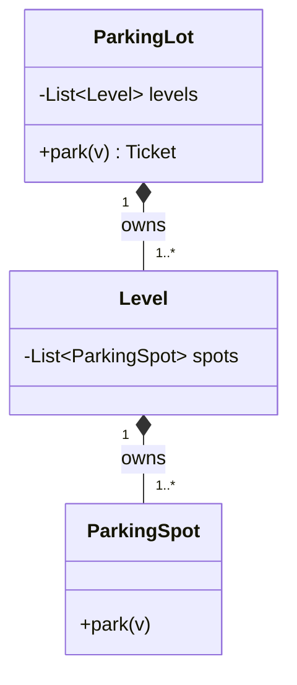
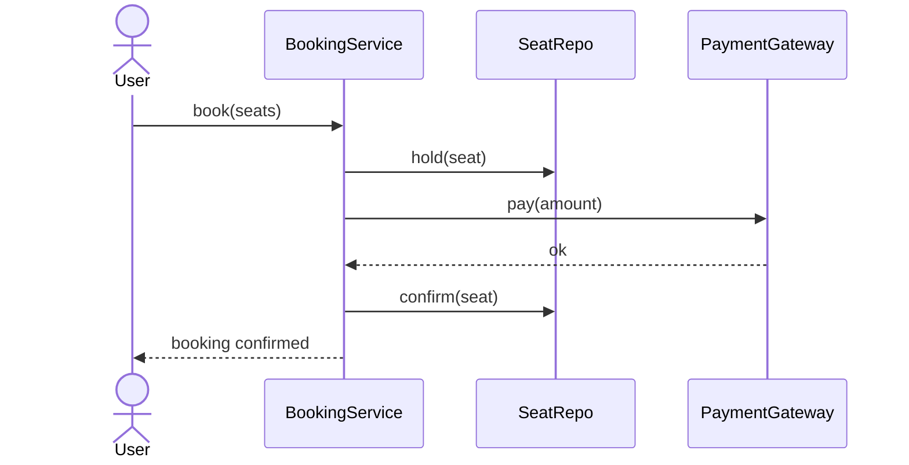

# LLD Roadmap - Fundamentals in Depth

The [overview](lld-overview.md) lists an 8-step learning roadmap; this page explains each step in
depth with examples and trade-offs.

!!! note "Language"
    Examples are in **Python** (primary) with **Java** equivalents shown wherever the Java idiom
    matters for LLD rounds (interfaces, abstract classes, access modifiers, `static`/`final`) -
    Java is where most LLD interviews happen. For Java syntax as a standalone reference, see the
    [Java Cheat Sheet](java-cheatsheet.md).

!!! tip "Canonical code reference"
    This page teaches the *concepts and trade-offs*. For a compact, runnable set of SOLID + GoF
    pattern examples in one place, see the [Low-Level Design Guide](LowLevelDesign.md). OOP pillars
    at the fundamentals level live in
    [Fundamentals → OOP & Language](../Fundamentals/oop-and-language-concepts.md).

## Roadmap at a glance

1. [OOP basics](#1-oop-basics) - class, object, constructor, `static`, `final`, overloading vs overriding
2. [Four pillars](#2-four-pillars-of-oop) - encapsulation, abstraction, inheritance, polymorphism
3. [Relationships](#3-relationships) - association, aggregation, composition
4. [SOLID](#4-solid-principles) - the five design principles
5. [Interface vs abstract](#5-interface-vs-abstract-class) - when to use which
6. [Design patterns](#6-design-patterns) - creational, structural, behavioral
7. [UML](#7-uml-basics) - class & sequence diagrams
8. [Practice](#8-practice-mocks) - how to actually get good

---

# 1. OOP basics

The vocabulary everything else is built on. In an LLD round you won't be *asked* "what is a
constructor" - but you use all of this constantly, so it must be automatic.

## Class vs object

- **Class** = a blueprint / template. Defines what fields (state) and methods (behavior) a
  thing has.
- **Object** = a concrete instance of a class, with its own copy of the state.

One class → many objects. `Vehicle` is the class; *your specific car* is an object.

```python
class Vehicle:
    def __init__(self, plate: str, wheels: int):
        self.plate = plate        # instance field (state)
        self.wheels = wheels

    def describe(self) -> str:    # method (behavior)
        return f"{self.plate} has {self.wheels} wheels"

car = Vehicle("KA01AB1234", 4)   # object / instance
bike = Vehicle("KA02CD5678", 2)  # a different object
print(car.describe())            # KA01AB1234 has 4 wheels
```

```java
// Java
public class Vehicle {
    private String plate;        // state
    private int wheels;

    public Vehicle(String plate, int wheels) {  // constructor
        this.plate = plate;
        this.wheels = wheels;
    }

    public String describe() {   // behavior
        return plate + " has " + wheels + " wheels";
    }
}

Vehicle car = new Vehicle("KA01AB1234", 4);  // 'new' creates the object
```

## Constructor

Special method that runs when an object is created; it initializes state.

- **Python:** `__init__`. There's effectively one constructor; you simulate "multiple
  constructors" with default arguments or `@classmethod` factory methods.
- **Java:** a method with the class's name and no return type. You can have **multiple
  constructors** (constructor overloading) with different parameter lists.

```python
class Booking:
    def __init__(self, user, seats, discount=0.0):   # default param = "optional constructor"
        self.user = user
        self.seats = seats
        self.discount = discount

    @classmethod
    def free(cls, user):             # alternate constructor via classmethod
        return cls(user, seats=[], discount=0.0)
```

```java
public class Booking {
    private String user;
    private List<String> seats;
    private double discount;

    public Booking(String user, List<String> seats) {   // constructor 1
        this(user, seats, 0.0);                          // delegates to constructor 2
    }
    public Booking(String user, List<String> seats, double discount) {  // constructor 2
        this.user = user;
        this.seats = seats;
        this.discount = discount;
    }
}
```

## `static` vs instance

- **Instance member** - belongs to each object; each object has its own copy.
- **Static member** - belongs to the **class itself**, shared by all objects. Used for
  constants, counters, factory methods, and utility functions that don't need object state.

```python
class ParkingLot:
    MAX_LEVELS = 10          # class-level constant (shared)
    _count = 0               # shared counter across all instances

    def __init__(self, name):
        self.name = name     # instance state
        ParkingLot._count += 1

    @staticmethod
    def is_valid_plate(plate: str) -> bool:   # no self - pure utility
        return len(plate) == 10

    @classmethod
    def total_created(cls) -> int:            # operates on the class, not an instance
        return cls._count
```

```java
public class ParkingLot {
    public static final int MAX_LEVELS = 10;   // 'static final' = shared constant
    private static int count = 0;              // shared across all instances
    private String name;

    public ParkingLot(String name) {
        this.name = name;
        count++;
    }

    public static boolean isValidPlate(String plate) {  // call as ParkingLot.isValidPlate(...)
        return plate.length() == 10;
    }
}
```

**Interview relevance:** Singleton (one DB instance), constants, and ID generators all lean
on `static`.

## `final` (Java) / constants & immutability (Python)

`final` in Java means "cannot change after assignment":

- `final` variable → a constant (can't reassign)
- `final` method → can't be overridden by a subclass
- `final` class → can't be extended (e.g. `String`)

Python has no true `final`. Conventions / tools instead:

- `UPPER_CASE` names signal "constant, don't reassign" (not enforced)
- `typing.Final` is a type-checker hint: `MAX: Final[int] = 10`
- Immutability via `@dataclass(frozen=True)` or `tuple`/`namedtuple`

```python
from dataclasses import dataclass

@dataclass(frozen=True)       # instances can't be mutated after creation
class Point:
    x: int
    y: int

p = Point(1, 2)
# p.x = 5  -> raises FrozenInstanceError
```

```java
public final class Point {          // final class: cannot be subclassed
    private final int x;             // final field: set once in constructor
    private final int y;
    public Point(int x, int y) { this.x = x; this.y = y; }
    public int getX() { return x; }  // no setter -> immutable
}
```

## Overloading vs overriding (classic interview trap)

| | **Overloading** | **Overriding** |
|---|---|---|
| What | Same method name, **different parameters**, in the **same class** | Subclass **redefines** a method it inherited (same name + params) |
| Resolved at | **Compile time** (static polymorphism) | **Runtime** (dynamic polymorphism) |
| Relationship | No inheritance needed | Requires inheritance |
| Python support | **Not native** - last definition wins; simulate with default args / `*args` / `functools.singledispatch` | Fully supported - just redefine the method |

```python
# OVERRIDING in Python
class Vehicle:
    def fare(self) -> int:
        return 10

class Bike(Vehicle):
    def fare(self) -> int:      # overrides the parent
        return 5

# OVERLOADING is not native - this does NOT create two methods:
class Calc:
    def add(self, a, b): ...
    def add(self, a, b, c): ...   # this REPLACES the one above
# Idiomatic workaround:
class Calc2:
    def add(self, *nums):          # variable args
        return sum(nums)
```

```java
// OVERLOADING - two real methods, chosen at compile time by argument types
class Calc {
    int add(int a, int b)        { return a + b; }
    int add(int a, int b, int c) { return a + b + c; }   // same name, different params
}

// OVERRIDING - @Override annotation, resolved at runtime
class Vehicle { int fare() { return 10; } }
class Bike extends Vehicle {
    @Override int fare() { return 5; }
}
```

---

# 2. Four pillars of OOP

Don't memorize definitions - understand *why* each exists and the boundary it sets.

## Encapsulation - bundle state + behavior, hide the internals

Keep data and the methods that operate on it in one class, and expose **only** a controlled
interface. The outside world touches your object through methods, not by poking fields
directly. This lets you change internals without breaking callers and enforce invariants
(validation).

```python
class BankAccount:
    def __init__(self, balance: float):
        self.__balance = balance          # name-mangled -> "private" by convention

    def deposit(self, amount: float):
        if amount <= 0:
            raise ValueError("amount must be positive")   # invariant enforced here
        self.__balance += amount

    @property
    def balance(self) -> float:           # controlled read access
        return self.__balance
```

```java
public class BankAccount {
    private double balance;               // truly private - compiler enforced

    public void deposit(double amount) {
        if (amount <= 0) throw new IllegalArgumentException("positive only");
        this.balance += amount;
    }
    public double getBalance() { return balance; }   // getter; no setter = read-only
}
```

- **Python** has no hard private: `_x` = "internal, please don't touch", `__x` = name-mangled
  (harder to reach by accident). Enforcement is by convention + `@property`.
- **Java** enforces with `private` / `public` / `protected` and getters/setters.

> Interview tie-in: encapsulation is *how* you achieve SRP and loose coupling in practice.

## Abstraction - expose *what*, hide *how*

Show the user a simple set of operations and hide the complex implementation. The user
interacts with the **right methods** only and doesn't need to know the internal mechanism.

Encapsulation vs abstraction (they're related, not the same):
- **Abstraction** = design-level: *what* operations exist (the contract).
- **Encapsulation** = implementation-level: *hiding* the data/mechanism behind that contract.

```python
from abc import ABC, abstractmethod

class PaymentGateway(ABC):           # abstraction: defines WHAT, not HOW
    @abstractmethod
    def pay(self, amount: float) -> bool: ...

class RazorpayGateway(PaymentGateway):
    def pay(self, amount: float) -> bool:   # the HOW is hidden from callers
        # ... talk to Razorpay API ...
        return True

def checkout(gateway: PaymentGateway, amount: float):
    gateway.pay(amount)              # caller only knows the abstraction
```

```java
public interface PaymentGateway {    // pure abstraction
    boolean pay(double amount);
}
public class RazorpayGateway implements PaymentGateway {
    public boolean pay(double amount) { /* hidden impl */ return true; }
}
```

## Inheritance - reuse via an "is-a" relationship

A subclass inherits fields/methods from a parent and can add or override behavior. Use it
when the child genuinely **is a** kind of the parent.

⚠️ **Prefer composition over inheritance** (very common LLD advice). Deep inheritance trees
are rigid; "has-a" composition is more flexible. Use inheritance for true is-a, not just to
reuse code.

```python
class Vehicle:
    def __init__(self, plate): self.plate = plate
    def start(self): return "engine on"

class Car(Vehicle):              # Car IS-A Vehicle
    def start(self):             # override
        return "car " + super().start()
    def open_trunk(self):        # extra behavior
        return "trunk open"
```

```java
class Vehicle {
    protected String plate;
    String start() { return "engine on"; }
}
class Car extends Vehicle {       // 'extends' = inheritance
    @Override String start() { return "car " + super.start(); }
    String openTrunk() { return "trunk open"; }
}
```

- **Python** supports multiple inheritance (with MRO - method resolution order).
- **Java** has single class inheritance but a class can implement **multiple interfaces**.

### Trade-off: composition vs inheritance

| | **Inheritance** ("is-a") | **Composition** ("has-a") |
|---|---|---|
| Coupling | **Tight** - subclass depends on parent internals; a parent change can break children | **Loose** - the whole only uses the part's public API |
| Flexibility | Fixed at compile time; one parent (Java) | Swap/add behavior at runtime; combine many parts |
| Reuse | Reuse by extending | Reuse by delegating to held objects |
| Risk | Fragile base class, deep brittle hierarchies, LSP violations | More wiring/boilerplate, one extra layer of indirection |
| Best when | A true, stable is-a with shared state + behavior | Behavior varies, or you'd otherwise explode subclasses |

**The classic cost of over-inheritance** - a "class explosion": modelling `ElectricCar`,
`DieselCar`, `ElectricTruck`, `DieselTruck`... as subclasses multiplies combinatorially.
Composition (a `Car` *has* an `Engine`) collapses it to `Car(ElectricEngine())`.

> Rule of thumb: reach for inheritance only when the is-a is genuine *and* stable. If you're
> inheriting just to reuse code, that's a smell - delegate to a held object instead. Nearly
> every GoF pattern (Strategy, Decorator, Adapter) is "favor composition" in disguise.

## Polymorphism - one interface, many forms

Same call, different behavior depending on the actual object type. This is what makes code
**extensible**: callers depend on the abstract type, new subtypes slot in without changing
the caller.

```python
def total_fare(vehicles: list[Vehicle]) -> int:
    return sum(v.fare() for v in vehicles)   # each v.fare() runs ITS own version

total_fare([Car(...), Bike(...)])   # works for any current or FUTURE Vehicle subtype
```

- **Runtime (dynamic) polymorphism** = overriding (shown above).
- **Compile-time (static) polymorphism** = overloading (Java; not native in Python).

> This is the pillar that powers OCP, Strategy, Factory - most of LLD, really.

---

# 3. Relationships

> The overview covers the intuition; this is the modeling detail. The litmus question stays:
> **"If the whole disappears, does the part still make sense?"**

| Relationship | Meaning | Lifecycle | "If whole dies..." | UML arrow |
|---|---|---|---|---|
| **Association** | Two classes know/use each other | Independent | both live on | plain line (→) |
| **Aggregation** | Whole *has* parts, parts shared/reusable | Independent | **part survives** | hollow diamond (◇-) |
| **Composition** | Whole *owns* parts exclusively | Bound together | **part dies too** | filled diamond (◆-) |

The practical difference is **who creates and owns the part**.

## Association - "uses / knows"

Objects reference each other but neither owns the other's lifecycle.

```python
class Driver:
    def __init__(self, name): self.name = name

class Trip:
    def __init__(self, driver: Driver):   # Trip uses a Driver that exists independently
        self.driver = driver

d = Driver("Asha")
t = Trip(d)     # the driver existed before the trip and outlives it
```

Direction: can be **uni-directional** (Trip knows Driver) or **bi-directional** (both know
each other). Keep it uni-directional unless you truly need both ways.

## Aggregation - "has-a", shared ownership

The whole holds parts, but parts are **passed in** from outside and can outlive the whole /
be shared by multiple wholes.

```python
class User:
    def __init__(self, name): self.name = name

class Group:                              # Splitwise group
    def __init__(self, name):
        self.name = name
        self.members: list[User] = []
    def add(self, user: User):            # user created ELSEWHERE, just referenced
        self.members.append(user)

u = User("Ravi")
g = Group("Goa Trip")
g.add(u)        # delete g -> u still exists (and may be in other groups)
```

Tell-tale sign: the part is **injected** (constructor/setter) rather than created inside.

## Composition - "owns-a", exclusive ownership

The whole **creates** its parts and they die with it. The part has no meaning alone.

```python
class Seat:
    def __init__(self, label): self.label = label

class Screen:
    def __init__(self, n_seats: int):
        # Screen CREATES its own seats -> it owns them
        self.seats = [Seat(f"S{i}") for i in range(n_seats)]

scr = Screen(100)   # destroy scr -> its seats are meaningless/gone too
```

Tell-tale sign: the part is **created inside** the whole and not shared.

> Why interviewers care: choosing composition vs aggregation decides who's responsible for
> creating, validating, and destroying objects - and whether a `delete` should cascade.

### Trade-off: aggregation vs composition

- **Pick composition** when the part is meaningless alone and shares the whole's lifecycle
  (Screen→Seat). Upside: the whole fully controls invariants and cleanup (cascade delete),
  so no dangling references. Downside: the part can't be shared or reused elsewhere, and it's
  harder to unit-test the part in isolation (it's created inside).
- **Pick aggregation** when the part exists independently and may be shared (Group→User).
  Upside: reuse, independent lifecycle, easy to inject a fake for testing. Downside: *you* now
  own the harder questions - what happens to the part when the whole dies? who validates it?
  dangling references are possible.

> Default to the **loosest** relationship that models reality. Over-stating it as composition
> when it's really aggregation bakes in a cascade-delete you'll regret (deleting a trip group
> shouldn't delete the users). Under-stating composition as aggregation leaks ownership and
> lets invariants break.

---

# 4. SOLID principles

> The overview has the one-liners; here is each with a bad→good example. SOLID is the
> *language* of LLD - most "why did you design it this way?" answers reference a SOLID letter.

## S - Single Responsibility Principle (SRP)

A class should have **one reason to change** / one job.

```python
# BAD - three reasons to change (storage, email format, invoice format) in one class
class User:
    def save(self): ...          # DB concern
    def send_email(self): ...    # notification concern
    def to_invoice(self): ...    # reporting concern

# GOOD - split responsibilities
class User: ...                  # just the data/behavior of a user
class UserRepository:            # persistence only
    def save(self, u: User): ...
class EmailService:              # notification only
    def send(self, u: User): ...
```

Smell: a class named `...Manager`/`...Helper` doing five unrelated things.

## O - Open/Closed Principle (OCP)

Open for **extension**, closed for **modification**. Add behavior by adding new code, not by
editing tested code (usually via polymorphism).

```python
# BAD - every new shape edits this function
def area(shape):
    if shape.kind == "circle": ...
    elif shape.kind == "square": ...     # must edit to add triangle

# GOOD - add a subclass, don't touch existing code
from abc import ABC, abstractmethod
class Shape(ABC):
    @abstractmethod
    def area(self) -> float: ...
class Circle(Shape):
    def area(self): return 3.14 * self.r * self.r
class Square(Shape):
    def area(self): return self.s * self.s
# new shape = new class; area() callers never change
```

## L - Liskov Substitution Principle (LSP)

A subclass must be usable **anywhere its parent is**, with no surprises. If substituting the
child breaks the caller's expectations, the hierarchy is wrong.

```python
# CLASSIC VIOLATION: Square "is-a" Rectangle breaks setWidth/setHeight expectations
class Rectangle:
    def set_width(self, w): self.w = w
    def set_height(self, h): self.h = h
    def area(self): return self.w * self.h

class Square(Rectangle):        # forcing w==h violates what callers expect of a Rectangle
    def set_width(self, w): self.w = self.h = w   # surprising side effect!
# a function that sets width=5, height=4 and expects area 20 now gets 16 -> LSP broken
```

Fix: don't force a false is-a. Model `Square` and `Rectangle` separately (or via a common
`Shape` abstraction). Rule of thumb: a subclass should **not strengthen preconditions or
weaken postconditions**.

## I - Interface Segregation Principle (ISP)

No **fat interfaces**. Prefer several small, focused interfaces over one big one so clients
only depend on what they use.

```python
# BAD - a printer that isn't a scanner is forced to implement scan()/fax()
class Machine(ABC):
    @abstractmethod
    def print(self): ...
    @abstractmethod
    def scan(self): ...      # a simple printer can't honor this
    @abstractmethod
    def fax(self): ...

# GOOD - split capabilities
class Printer(ABC):
    @abstractmethod
    def print(self): ...
class Scanner(ABC):
    @abstractmethod
    def scan(self): ...
class AllInOne(Printer, Scanner): ...   # compose only what applies
```

```java
interface Printer { void print(); }
interface Scanner { void scan(); }
class SimplePrinter implements Printer { public void print() {} }       // not forced to scan
class AllInOne implements Printer, Scanner { /* ... */ }
```

## D - Dependency Inversion Principle (DIP)

High-level modules shouldn't depend on low-level ones - **both depend on an abstraction**.
Depend on interfaces, inject the concrete implementation.

```python
# BAD - OrderService is welded to MySQL
class OrderService:
    def __init__(self):
        self.db = MySQLDatabase()      # hard dependency; can't swap, can't test

# GOOD - depend on an abstraction, inject the concrete type
class Database(ABC):
    @abstractmethod
    def save(self, data): ...
class MySQLDatabase(Database):
    def save(self, data): ...
class OrderService:
    def __init__(self, db: Database):  # dependency injection
        self.db = db
OrderService(MySQLDatabase())          # swap to MongoDatabase() / FakeDatabase() freely
```

> DIP is what makes code **testable** (inject a fake) and **swappable** (change DB without
> touching business logic). Spring's `@Autowired` / constructor injection is DIP in practice.

## Trade-off: SOLID is a guideline, not a law

SOLID is not free - every principle trades simplicity for flexibility, and over-applying it
is as much a red flag as ignoring it.

| Principle | Cost of over-applying |
|---|---|
| SRP | Death by a thousand tiny classes; logic scattered, hard to follow a flow |
| OCP | Premature abstraction - interfaces/strategies for variation that never comes (YAGNI) |
| LSP | Usually safe, but forcing a hierarchy to "satisfy LSP" can be more awkward than two separate types |
| ISP | Interface fragmentation - dozens of one-method interfaces nobody can navigate |
| DIP | Indirection everywhere; a simple call now hops through an interface + a DI container |

**The SDE-2 judgement:** apply a principle when there's a *real, expected* axis of change.
Adding a `PaymentGateway` interface is worth it (you *will* add payment methods). Adding a
`VehicleColorStrategy` interface for a color that never varies is cargo-culting. State the
expected change that justifies each abstraction - "I'm making this an interface because we'll
plug in card/UPI/wallet" beats "best practice says interface."

> Rule: start concrete and simple; introduce an abstraction at the *second* reason to change,
> not the first. A design that's easy to read and slightly under-abstracted beats a
> "perfectly SOLID" one nobody can follow in 45 minutes.

---

# 5. Interface vs abstract class

A spot people get confused - and interviewers probe it directly.

| | **Interface** | **Abstract class** |
|---|---|---|
| Represents | A **capability / contract** ("can do X") | A **partial base type** ("is a kind of X") |
| State (fields) | No instance state (constants only) | Can have fields / constructors |
| Methods | Signatures (Java 8+ allows `default`/`static` bodies) | Mix of abstract + concrete methods |
| Multiple | A class can implement **many** | A class extends **one** (Java) |
| Use when | Unrelated classes share a capability (`Comparable`, `Serializable`, `PaymentGateway`) | Related classes share **common state + partial behavior** (`Vehicle` with shared fields) |

**Rule of thumb:**
- Shared *behavior contract* across possibly-unrelated types → **interface**.
- Shared *state + default behavior* among closely related types → **abstract class**.
- Parking lot example: `Vehicle` (shared fields: engine, wheels) → **abstract class**;
  `SpotAllocationStrategy` (pure pluggable behavior) → **interface**.

```python
# Python: abc gives you both. An ABC with only abstractmethods ~ interface.
from abc import ABC, abstractmethod

class SpotAllocationStrategy(ABC):        # "interface" - pure contract
    @abstractmethod
    def allocate(self, spots): ...

class Vehicle(ABC):                        # "abstract class" - shared state + partial behavior
    def __init__(self, plate: str):
        self.plate = plate                 # common state
    def honk(self) -> str:                 # concrete shared behavior
        return "beep"
    @abstractmethod
    def spot_size(self) -> str: ...        # each subtype must define
```

```java
// Java makes the distinction explicit
interface SpotAllocationStrategy {         // contract only
    Spot allocate(List<Spot> spots);
    default boolean isAvailable(Spot s) { return s.isFree(); }  // Java 8+ default method
}

abstract class Vehicle {                   // shared state + partial behavior
    protected String plate;
    Vehicle(String plate) { this.plate = plate; }
    String honk() { return "beep"; }       // concrete
    abstract String spotSize();            // subclass must implement
}
```

### Trade-off: which one, and the hidden costs

- **Interface** - upside: a class can implement many, so you avoid locking a type into one
  hierarchy; keeps things decoupled. Downside: no shared state or implementation, so common
  code gets duplicated across implementers (Java 8 `default` methods soften this but can't
  hold state).
- **Abstract class** - upside: shares state + partial behavior, cutting duplication. Downside:
  uses up the **single** inheritance slot (Java), and tightly couples subclasses to the base -
  a base change ripples to every child (fragile base class).

**Default for extensibility: prefer the interface.** It leaves the inheritance slot free and
keeps coupling loose; add an abstract *base implementation* only when real shared state/logic
emerges. Common pattern: ship both - a small interface (`List`) plus an abstract helper
(`AbstractList`) so implementers can pick. Don't reach for an abstract class just to share two
lines of code - a helper/util or composition is lighter.

---

# 6. Design patterns

> Overview has the buckets + examples. Here's a usable template per pattern. **Don't
> memorize - recognize.** Only reach for a pattern when it genuinely simplifies the code.

## Creational - how objects are born

### Singleton - exactly one instance
Use for: config, logging, connection pool, a single in-memory store.

```python
class ConfigStore:
    _instance = None
    def __new__(cls):
        if cls._instance is None:
            cls._instance = super().__new__(cls)
        return cls._instance
# Pythonic alternative: just use a module - modules are singletons.
```

```java
public class ConfigStore {
    private static ConfigStore instance;
    private ConfigStore() {}                     // private ctor blocks 'new'
    public static synchronized ConfigStore getInstance() {  // thread-safe lazy init
        if (instance == null) instance = new ConfigStore();
        return instance;
    }
}
```
**Trade-offs:** upside - guaranteed single instance, lazy init, global access point. Downside
- it's effectively **global mutable state** (the thing OOP tries to avoid): hidden
dependencies, hard to unit-test (can't inject a fake), and a thread-safety burden (the
`synchronized`/double-checked-locking dance in Java). *Preferred alternative:* create one
instance at the top and **inject** it (DIP) - you get "one instance" without the global. Reach
for a true Singleton only when the single-instance constraint must be enforced by the class
itself (e.g. a hardware/driver handle).

### Factory - delegate object creation
Use for: creating one of several subtypes based on input, hiding `new` from callers.

```python
class VehicleFactory:
    @staticmethod
    def create(kind: str) -> Vehicle:
        return {"car": Car, "bike": Bike, "truck": Truck}[kind]()
```
Caller asks for `"car"`; it doesn't know/commit to the concrete class → supports OCP + DIP.

**Trade-offs:** upside - decouples callers from concrete classes, centralizes creation logic,
easy to add a new type. Downside - a `dict`/`switch` registry still has to be edited for each
new type (a mild OCP leak; a self-registering registry fixes it at the cost of complexity),
and a factory for a *single* concrete type is pure ceremony. Don't add a factory until
creation actually varies.

### Builder - construct complex objects step by step
Use for: objects with many optional fields (avoids telescoping constructors).

```python
from dataclasses import dataclass, field

@dataclass
class Booking:
    user: str
    seats: list = field(default_factory=list)
    discount: float = 0.0
    snacks: list = field(default_factory=list)

class BookingBuilder:
    def __init__(self, user): self._b = Booking(user)
    def seats(self, s):    self._b.seats = s;      return self   # fluent chaining
    def discount(self, d): self._b.discount = d;   return self
    def snacks(self, s):   self._b.snacks = s;      return self
    def build(self):       return self._b

booking = BookingBuilder("ravi").seats(["A1","A2"]).discount(0.1).build()
```
**Trade-offs:** upside - readable step-by-step construction, no telescoping constructors, can
validate in `build()`, supports immutable results. Downside - a whole extra class and more
code; overkill for 2-3 fields. Language matters: in **Python**, `@dataclass` with keyword
defaults covers most cases, so a Builder is rarely needed; in **Java**, keyword args don't
exist, so the Builder genuinely earns its place for many-optional-field objects (or use a
`record` when all fields are required). Mention this language difference explicitly - it's a
sharp signal.

## Structural - how objects are wired

### Adapter - make two incompatible interfaces fit
Use for: integrating a third-party/legacy class whose interface differs from what you expect.

```python
class PhonePeApi:                       # third-party, "wrong" shape
    def make_payment(self, paise: int): ...

class PaymentGateway(ABC):              # what our system expects
    @abstractmethod
    def pay(self, rupees: float): ...

class PhonePeAdapter(PaymentGateway):   # adapter translates one to the other
    def __init__(self, api: PhonePeApi): self.api = api
    def pay(self, rupees: float):
        self.api.make_payment(int(rupees * 100))   # rupees -> paise
```

**Trade-offs:** upside - integrate third-party/legacy code without touching it or your core,
isolating the external dependency behind your own interface (easy to swap vendors later).
Downside - an extra layer and the risk of hiding an *impedance mismatch* (if the two models
differ semantically, not just syntactically, the adapter leaks). *When you control both
sides*, don't adapt - just align the interfaces directly.

### Decorator - add behavior at runtime without subclassing
Use for: stackable add-ons (toppings, discounts, middleware).

```python
class Coffee(ABC):
    @abstractmethod
    def cost(self) -> float: ...
    @abstractmethod
    def desc(self) -> str: ...

class Plain(Coffee):
    def cost(self): return 100
    def desc(self): return "coffee"

class AddOn(Coffee):                     # wraps another Coffee
    def __init__(self, inner: Coffee): self.inner = inner

class Caramel(AddOn):
    def cost(self): return self.inner.cost() + 20
    def desc(self): return self.inner.desc() + " + caramel"

drink = Caramel(Plain())                 # stack as many as you like
print(drink.desc(), drink.cost())        # coffee + caramel 120
```

**Trade-offs:** upside - add/combine behaviors at runtime without a subclass explosion
(`Caramel+Whip+Soy` is composition, not 2³ subclasses); each decorator is one small SRP-clean
class. Downside - many tiny wrapper classes, debugging through layers is painful, and order
can matter (tax-then-discount ≠ discount-then-tax). For a single, fixed add-on a plain field
or subclass is simpler.

## Behavioral - how objects decide & communicate

### Strategy - swap an algorithm at runtime
Use for: multiple interchangeable ways to do one thing (parking spot allocation, pricing,
sorting). This is the parking-lot example from the overview.

```python
class SpotAllocationStrategy(ABC):
    @abstractmethod
    def pick(self, spots): ...

class NearestToEntry(SpotAllocationStrategy):
    def pick(self, spots): return min(spots, key=lambda s: s.dist_to_entry)
class NearestToElevator(SpotAllocationStrategy):
    def pick(self, spots): return min(spots, key=lambda s: s.dist_to_elevator)

class ParkingLot:
    def __init__(self, strategy: SpotAllocationStrategy):
        self.strategy = strategy         # inject; change without touching ParkingLot
    def park(self, spots):
        return self.strategy.pick(spots)
```

**Trade-offs:** upside - swap algorithms at runtime, add new ones without touching the context
(textbook OCP), and test each in isolation. Downside - a class/interface per algorithm plus
the wiring to choose one; for **two fixed branches a plain `if/else` is clearer**. The tell
that Strategy earns its place: the set of algorithms grows, or callers should pick at runtime.
(In Python/Java a strategy can be just a lambda/function - no class needed - which cuts the
boilerplate cost significantly.)

### Observer - publish/subscribe on state change
Use for: one object's change notifying many (notifications, event systems, "seat booked →
update all screens").

```python
class Observer(ABC):
    @abstractmethod
    def update(self, event): ...

class Subject:
    def __init__(self): self._observers: list[Observer] = []
    def subscribe(self, o: Observer): self._observers.append(o)
    def notify(self, event):
        for o in self._observers: o.update(event)
```

**Trade-offs:** upside - decouples the subject from its listeners (subject doesn't know who's
watching), listeners added/removed at runtime. Downside - the notification order is
non-obvious, debugging an event cascade is hard, and you must **unsubscribe** or you leak
memory (dangling listeners). Watch for accidental sync chains where one `notify` triggers
another. Fine for a handful of listeners; for high-volume cross-service events a real
message queue beats hand-rolled Observer.

### State - behavior changes with internal state
Use for: objects that act differently per state (booking: CREATED → HELD → PAID → CANCELLED;
vending machine; traffic light). Each state is a class that knows the valid transitions -
avoids giant `if/elif` state checks.

**Trade-offs:** upside - each state is one SRP-clean class, illegal transitions become
impossible by construction, and adding a state doesn't touch the others (OCP). Downside - a
class per state is heavy for 2-3 states (a simple `enum` + `if` is fine there), and the
transition logic gets spread across many files, so the overall state machine is harder to see
at a glance. Worth it once transitions are numerous or genuinely complex.

---

# 7. UML basics

You don't need full UML - just enough to communicate on a whiteboard. Two diagrams matter.

## Class diagram - the structure
Boxes = classes (name / fields / methods). Lines = relationships.



Relationship arrows (memorize these - you'll draw them live):
- `──▷`  **inheritance / implements** (hollow triangle, points to parent/interface)
- `◆──`  **composition** (filled diamond on the owner; part dies with whole)
- `◇──`  **aggregation** (hollow diamond on the owner; part survives)
- `───`  **association** (plain line; add `→` for direction)
- `- - ▷` **dependency** (dashed; "uses temporarily", e.g. a param)

Multiplicity on the line ends: `1`, `0..1`, `1..*`, `*` (e.g. `ParkingLot 1 ──◆ 1..* Level`).

## Sequence diagram - the behavior over time
Shows the order of calls between objects for one scenario. Useful for flows like "book a
seat".



Lifelines run top-to-bottom; arrows are messages/calls in time order.

For the modeling process as flowcharts and a "which pattern?" decision tree, see
[LLD Mental Models](lld-mental-models.md).

---

# 8. Practice & mocks

Patterns click only through reps - same as recognizing a sliding-window problem in DSA.

**Progression (easy → hard):**
1. Library management system
2. BookMyShow / District (movie booking) - the worked example in the overview
3. Parking lot
4. Splitwise
5. Vending machine / ATM / elevator
6. Then the hard, concurrency-heavy ones (Uber, rate limiter, logging framework) -
   companies like Uber / Walmart / Flipkart push on multi-threading here

**How to practice each one:**
1. Spend 5 min only on **clarifying questions** (follow the 7-step framework in the overview)
2. Pull **nouns → prune to real classes** (drop attributes)
3. Classify each relationship: association / aggregation / composition
4. Write classes + methods; pick interfaces vs abstract classes deliberately
5. Apply SOLID; add a pattern **only** where it earns its place (state the rationale)
6. **Break your own design**: add a new requirement (new vehicle type, new payment method,
   new allocation strategy) and check nothing existing has to change - if it does, your OCP
   is weak
7. Do it on **paper** for 5 random apps on your phone, then code the working demo

**Interview-day reminders:**
- Think out loud constantly (silence = red flag)
- One class, one responsibility - finish it before starting the next
- Always land a **working demo** - it's the entry ticket
- Justify every pattern ("Builder because the booking has many optional fields")

> Next topic to deepen: **concurrency / multi-threading in LLD** (locks, thread-safety for the
> in-memory store, double-booking prevention) - the genuinely hard part. See
> [Concurrency](concurrency.md).

## Related

- [Overview & framework](lld-overview.md) · [Concurrency](concurrency.md) ·
  [Extended Patterns](patterns-extended.md) · [Java Cheat Sheet](java-cheatsheet.md)
- Fully solved, runnable problems with trade-offs → [Worked Problems](worked-problems.md)
- Compact SOLID + GoF reference → [Low-Level Design Guide](LowLevelDesign.md)
- Visual modeling (flowcharts, decision trees) → [LLD Mental Models](lld-mental-models.md)
- Mock interview practice → [Behavioral → Mock Practice](../Behavioral/MockPracticeFramework.md)
