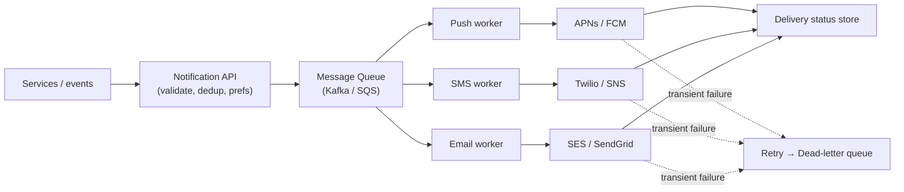

# Notification System Design
> **SDE-2 Interview Ready** | 45-minute format

## Problem Statement

Design a system that sends notifications to users across multiple channels — push (iOS/Android),
SMS, and email — reliably and at scale.

**Example:** an app sends order updates, promotions, and alerts to millions of users via whichever
channel(s) each user prefers.

---

## 1️⃣ Requirements Clarification

### Functional Requirements:
1. Send notifications via **push, SMS, email** (multi-channel).
2. Support triggered (event-driven) and scheduled/bulk sends.
3. Respect user **preferences** and opt-outs.
4. Deduplicate and don't spam; track delivery status.

### Non-Functional Requirements:
- **Scale:** millions of notifications/day, bursty.
- **Reliability:** at-least-once delivery; retries on transient failures.
- **Low coupling:** producers shouldn't block on third-party providers.
- **Extensible:** add new channels/providers easily.

### Out of Scope:
- Notification content authoring UI; analytics dashboards.

---

## 2️⃣ Capacity Estimation

```
10M notifications/day → 10M / 86,400 ≈ 116/sec average, peak ×5-10 for campaigns → ~1K/sec
Fan-out: one campaign to 10M users = 10M messages queued in a burst
Third-party providers (APNs/FCM/Twilio/SES) are the throughput ceiling → buffer with queues
```

---

## 3️⃣ API Design

```text
POST /v1/notifications
Body: {
  user_id: "u123",
  type: "ORDER_SHIPPED",
  channels: ["push", "email"],   # optional; else use user prefs
  payload: { order_id: "...", ... },
  idempotency_key: "evt-98765"   # dedup retries
}
Response: { notification_id, status: "queued" }

GET /v1/notifications/{id}   → delivery status per channel
```

---

## 4️⃣ High-Level Design



<details class="example" markdown>
<summary>ASCII version</summary>

```
Services / events
      │  POST /notifications (or emit event)
      ▼
┌───────────────────┐
│ Notification API  │ → validate, dedup (idempotency key), look up prefs
└─────────┬─────────┘
          ▼
┌───────────────────┐
│   Message Queue   │  (Kafka/SQS — decouples + buffers bursts)
└─────────┬─────────┘
   ┌───────┼─────────┐
   ▼       ▼         ▼
┌──────┐┌──────┐ ┌──────┐   channel workers (consumers)
│ Push ││ SMS  │ │Email │
│worker││worker│ │worker│
└──┬───┘└──┬───┘ └──┬───┘
   ▼       ▼        ▼
 APNs/    Twilio   SES/       third-party providers
 FCM      /SNS     SendGrid
   │        │        │
   └────────┴────────┴──► delivery status → status store + retries (DLQ)
```

</details>

**Flow:** API validates + dedups + resolves channels from user prefs → enqueues per-channel messages
→ channel workers pull and call the provider → record status; failures retry, then go to a dead-letter
queue.

---

## 5️⃣ Database / Data Model

```sql
-- User channel preferences + contact info
CREATE TABLE user_prefs (
  user_id      VARCHAR PRIMARY KEY,
  push_token   VARCHAR,
  phone        VARCHAR,
  email        VARCHAR,
  opted_out    JSONB          -- e.g. {"promotions": true}
);

-- Delivery tracking (one row per notification per channel)
CREATE TABLE deliveries (
  id               BIGSERIAL PRIMARY KEY,
  notification_id  VARCHAR,
  user_id          VARCHAR,
  channel          VARCHAR,   -- push | sms | email
  status           VARCHAR,   -- queued | sent | delivered | failed
  idempotency_key  VARCHAR,
  attempts         INT DEFAULT 0,
  updated_at       TIMESTAMP DEFAULT NOW()
);
CREATE UNIQUE INDEX idx_dedup ON deliveries(idempotency_key, channel);
```

Templates live in a template store (versioned) so content is separated from code.

---

## 6️⃣ Deep Dives

### Deep Dive 1: Why a message queue is the core
Third-party providers are slow and rate-limited, and campaigns are bursty. A queue between the API
and channel workers **decouples** producers from providers, **absorbs spikes** (buffer), and enables
**retries/backpressure**. Producers return immediately after enqueuing. See
[message-queues.md](../components/message-queues.md).

### Deep Dive 2: Reliability — retries, idempotency, DLQ
Delivery is **at-least-once**, so a message can be retried and delivered twice. Make it safe:
- **Idempotency key** per notification; the worker/provider dedups so a retry doesn't double-send.
- **Retry with backoff** on transient provider errors; after N attempts move to a **dead-letter
  queue** for inspection.
This is the delivery-semantics discussion — see
[qa-concurrency.md](../../QA-Bank/qa-concurrency.md) (at-least/at-most/exactly-once).

### Deep Dive 3: Fan-out for campaigns
Sending to 10M users can't be one giant transaction. A fan-out service reads the audience, chunks it,
and enqueues messages in batches (respecting per-provider rate limits). Workers scale horizontally to
drain the queue.

### Deep Dive 4: User preferences, opt-outs, and rate limiting
Before sending, check the user's channel prefs and opt-outs (legal requirement for marketing).
Apply per-user rate limiting so a buggy producer can't spam one user (reuse the
[rate-limiter](rate-limiter.md) design). Quiet hours / frequency caps live here too.

### Deep Dive 5: Delivery status tracking
Providers send async delivery receipts (webhooks) — update the `deliveries` row from
`sent → delivered/failed`. This powers "why didn't my notification arrive" debugging and retry
decisions.

---

## 7️⃣ Bottlenecks & Optimizations

- **Provider rate limits** are the ceiling → per-provider queues + throttling, batch APIs where
  available.
- **Hot campaigns** → dedicated high-throughput queue/partition so transactional alerts aren't
  delayed behind marketing blasts (priority separation).
- **Template rendering** cost → cache rendered templates; personalize late.
- **Duplicate sends** → idempotency keys + dedup index.

---

## 8️⃣ Interview Tips

1. Center the design on a **queue + channel workers** (decoupling is the key idea).
2. Raise **at-least-once + idempotency + retries + DLQ** for reliability.
3. Handle **preferences/opt-outs** and **per-user rate limiting**.
4. Separate transactional (order shipped) from bulk (promotions) traffic.

### Common Follow-ups:
**Q: How do you avoid sending the same notification twice?** Idempotency key + dedup index.
**Q: How do you handle a provider outage?** Retry with backoff, DLQ, failover provider.
**Q: How do you send to 10M users fast?** Fan-out service chunks + batches into the queue; scale workers.
**Q: How do you respect user opt-outs?** Check prefs before enqueuing; legally required for marketing.

---

## Summary

**Key Decisions:**
1. ✅ **Message queue + per-channel workers** (decouple from slow providers).
2. ✅ **At-least-once + idempotency keys + retries + DLQ** for reliability.
3. ✅ **User prefs/opt-outs + per-user rate limiting**.
4. ✅ **Fan-out service** for campaigns; priority separation from transactional sends.

**Related:** [message-queues.md](../components/message-queues.md) ·
[rate-limiter.md](rate-limiter.md) ·
[qa-concurrency.md](../../QA-Bank/qa-concurrency.md)
