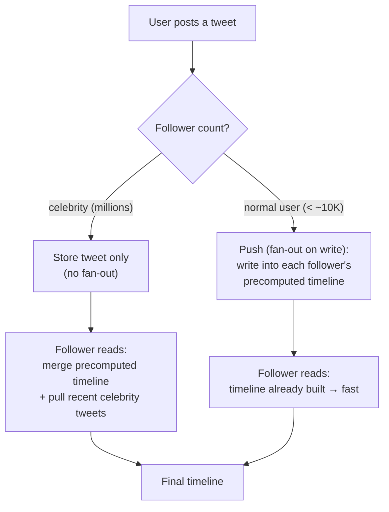

# Twitter System Design
> **SDE-2 Interview Ready** | 45-minute format

> **Also covers "Design a News Feed."** The news-feed problem is the timeline/fan-out core of this
> design — see **Deep Dive 1: Timeline Generation (Fanout)** below for push vs pull vs hybrid
> fan-out and the celebrity problem.

## 🎯 Problem Statement

Design a microblogging platform like Twitter (X) that allows:
- Post tweets (280 characters)
- Follow users
- Timeline (home feed)
- Search tweets
- Like, retweet, reply

**Key Requirements:**
- 400M users, 200M daily active users
- 500M tweets/day
- Read-heavy (read:write = 100:1)
- Timeline generation in <200ms

---

## 1️⃣ Requirements Clarification

### Functional Requirements:

1. **Tweeting**
   - Post tweet (text, images, videos)
   - Delete tweet
   - 280 character limit

2. **Timeline**
   - Home timeline (tweets from followed users)
   - User timeline (tweets by specific user)

3. **Social**
   - Follow/unfollow users
   - Like tweet
   - Retweet
   - Reply to tweet

4. **Search**
   - Search tweets by keywords, hashtags

### Non-Functional Requirements:
- **Scale:** 200M DAU, 500M tweets/day
- **Availability:** 99.9% uptime
- **Latency:** <200ms for timeline, <1sec for posting
- **Read-heavy:** 100:1 read-to-write ratio

### Out of Scope:
- Direct messages
- Trending topics
- Twitter Spaces (audio)

---

## 2️⃣ Capacity Estimation

```
Users: 400M total, 200M daily active users
Tweets per day: 500M
Tweets per second: 500M / 86400 = 5,800 tweets/sec

Timeline reads:
- Each user checks timeline 10 times/day
- 200M × 10 = 2B timeline reads/day
- 2B / 86400 = 23,000 reads/sec

Storage:
- Per tweet: 280 chars × 2 bytes (UTF-8) + metadata (100 bytes) = 660 bytes
- Daily: 500M × 660 bytes = 330 GB/day
- Yearly: 330 GB × 365 = 120 TB/year

Follower distribution:
- Average user follows 200 people
- Celebrities have 50M+ followers (Cristiano Ronaldo has 600M)
```

---

## 3️⃣ API Design

```text
# 1. Post Tweet
POST /v1/tweets
Body: {
  text: "Hello Twitter! #systemdesign",
  media_urls: ["https://cdn.twitter.com/img123.jpg"],  # optional
  reply_to: "tweet_xyz"  # optional
}

Response: {
  tweet_id: "abc123",
  user_id: "user_456",
  text: "Hello Twitter! #systemdesign",
  created_at: "2024-01-15T12:00:00Z",
  likes: 0,
  retweets: 0
}

# 2. Get Home Timeline
GET /v1/timeline/home
  ?user_id=user_456&page=1&limit=20

Response: {
  tweets: [
    {
      tweet_id: "abc123",
      user: { id: "user_789", name: "John", verified: true },
      text: "System design is fun!",
      created_at: "2024-01-15T12:05:00Z",
      likes: 150,
      retweets: 30,
      has_media: true
    }
  ],
  next_page: 2
}

# 3. Get User Timeline
GET /v1/timeline/user/{user_id}
  ?page=1&limit=20

Response: {
  tweets: [ ...user's tweets... ]
}

# 4. Follow User
POST /v1/users/{user_id}/follow
Body: { follower_id: "user_456" }

Response: {
  user_id: "user_789",
  follower_id: "user_456",
  followed_at: "2024-01-15T12:00:00Z"
}

# 5. Like Tweet
POST /v1/tweets/{tweet_id}/like
Body: { user_id: "user_456" }

Response: {
  tweet_id: "abc123",
  total_likes: 151,
  user_liked: true
}

# 6. Search Tweets
GET /v1/search
  ?query=systemdesign&page=1&limit=20

Response: {
  tweets: [ ...matching tweets... ],
  total: 5000
}
```

---

## 4️⃣ Database Design

### PostgreSQL (User Data, Relationships)

```sql
-- Users
CREATE TABLE users (
  id VARCHAR(50) PRIMARY KEY,
  username VARCHAR(50) UNIQUE,
  name VARCHAR(255),
  bio TEXT,
  verified BOOLEAN DEFAULT false,
  followers_count BIGINT DEFAULT 0,
  following_count BIGINT DEFAULT 0,
  created_at TIMESTAMP
);

-- Followers (Graph relationship)
CREATE TABLE followers (
  follower_id VARCHAR(50) REFERENCES users(id),
  followee_id VARCHAR(50) REFERENCES users(id),
  created_at TIMESTAMP,
  PRIMARY KEY (follower_id, followee_id)
);

CREATE INDEX idx_followers_followee ON followers(followee_id);
CREATE INDEX idx_followers_follower ON followers(follower_id);
```

### Cassandra (Tweets - Time-series)

```sql
-- Tweets (partitioned by user for fast user timeline)
CREATE TABLE tweets (
  user_id TEXT,
  tweet_id TIMEUUID,
  text TEXT,
  media_urls LIST<TEXT>,
  likes COUNTER,
  retweets COUNTER,
  created_at TIMESTAMP,
  PRIMARY KEY (user_id, tweet_id)
) WITH CLUSTERING ORDER BY (tweet_id DESC);

-- Home timeline (pre-computed feed for each user)
CREATE TABLE home_timeline (
  user_id TEXT,
  tweet_id TIMEUUID,
  author_id TEXT,
  created_at TIMESTAMP,
  PRIMARY KEY (user_id, tweet_id)
) WITH CLUSTERING ORDER BY (tweet_id DESC);
```

### Redis (Caching, Timeline)

```text
# Home timeline cache (most recent 100 tweets)
Key: timeline:home:{user_id}
Type: List
Value: [tweet_id1, tweet_id2, ...]
TTL: 1 hour

# Tweet cache
Key: tweet:{tweet_id}
Value: JSON { text, user_id, likes, ... }
TTL: 1 hour

# User cache
Key: user:{user_id}
Value: JSON { name, username, followers_count, ... }
TTL: 1 hour
```

### Elasticsearch (Search)

```json
{
  "mappings": {
    "properties": {
      "tweet_id": { "type": "keyword" },
      "text": { "type": "text" },
      "user_id": { "type": "keyword" },
      "hashtags": { "type": "keyword" },
      "created_at": { "type": "date" },
      "likes": { "type": "long" }
    }
  }
}
```

---

## 5️⃣ High-Level Design

```
┌──────────────┐
│    Users     │
└──────┬───────┘
       │
       ▼
┌──────────────────────────────────────┐
│   Load Balancer (NGINX)              │
└──────┬───────────────────────────────┘
       │
   ┌───┴────┬──────────┬────────────┐
   ▼        ▼          ▼            ▼
┌──────┐ ┌────────┐ ┌────────┐ ┌──────┐
│Tweet │ │Timeline│ │ Social │ │Search│
│Service│ │Service │ │Service │ │Service│
└──┬───┘ └───┬────┘ └───┬────┘ └──┬───┘
   │         │          │         │
   │         │          │         │
   ▼         ▼          ▼         ▼
┌──────────────────────────────────────┐
│         Data Layer                   │
│  ┌──────────┐  ┌──────────┐  ┌─────┐│
│  │Cassandra │  │PostgreSQL│  │Redis││
│  │ (Tweets) │  │ (Users)  │  │Cache││
│  └──────────┘  └──────────┘  └─────┘│
└──────────────────────────────────────┘
   │
   ▼
┌──────────────────────────────────────┐
│   Fanout Service (Kafka Workers)     │
│   - Pre-compute home timelines       │
└──────────────────────────────────────┘
```

---

## 6️⃣ Low-Level Design

### Class Diagram

```
┌─────────────────┐
│  TweetService   │
├─────────────────┤
│ + postTweet()   │
│ + deleteTweet() │
└────┬────────────┘
     │ uses
     ▼
┌─────────────────┐
│ FanoutService   │
├─────────────────┤
│ + fanoutTweet() │
└─────────────────┘
```

### Sequence Diagram (Post Tweet + Fanout)

```
User  TweetService  Cassandra  Kafka  FanoutService  Redis
 │         │            │        │          │          │
 │─Post───>│            │        │          │          │
 │         │            │        │          │          │
 │         │─Store─────>│        │          │          │
 │         │            │        │          │          │
 │         │─Publish────────────>│          │          │
 │         │   (TweetPosted)     │          │          │
 │<────────│            │        │          │          │
 │ tweet_id│            │        │          │          │
 │         │            │        │─Consume─>│          │
 │         │            │        │          │          │
 │         │            │        │          │─Fanout──>│
 │         │            │        │          │  (push to│
 │         │            │        │          │ followers)│
```

---

## 7️⃣ Deep Dives

### Deep Dive 1: Timeline Generation (Fanout)

**Challenge:** When user A posts tweet, push to 50M followers' timelines

**Solution: Hybrid Fanout (Push + Pull)**



Why hybrid: pure push is too expensive for celebrities (50M writes per tweet); pure pull is too slow
for every read. Push for the many, pull for the few, merge at read time.


**Push Model (Write Fanout):**
```text
# When user posts tweet, push to all followers' timelines

FUNCTION fanoutTweet(tweet):
    # 1. Get user's followers
    followers = getFollowers(tweet.user_id)

    # 2. For each follower, add tweet to their home timeline
    FOR EACH followerId IN followers:
        # Push to Redis (fast)
        list-prepend tweet.id to "timeline:home:{followerId}"
        trim "timeline:home:{followerId}" to keep only indices 0..999   # Keep last 1000

    # 3. Also store in Cassandra (durable), in parallel for all followers
    FOR EACH followerId IN followers (in parallel):
        execute Cassandra "INSERT INTO home_timeline (user_id, tweet_id, author_id, created_at)
                           VALUES (followerId, tweet.id, tweet.user_id, current time)"
END FUNCTION
```

**Problem:** Celebrities with 50M followers → 50M writes per tweet!

**Solution: Hybrid Approach**

```text
FUNCTION fanoutTweet(tweet):
    user = getUser(tweet.user_id)

    # 1. If user has < 10K followers → Push (write fanout)
    IF user.followers_count < 10000:
        pushFanout(tweet)
    # 2. If user has > 10K followers → Pull (read fanout)
    ELSE:
        pullFanout(tweet)
END FUNCTION

FUNCTION pushFanout(tweet):
    # Write to all followers' timelines (as shown above)
    followers = getFollowers(tweet.user_id)
    FOR EACH followerId IN followers:
        list-prepend tweet.id to "timeline:home:{followerId}"
END FUNCTION

FUNCTION pullFanout(tweet):
    # Just store tweet, don't fanout
    # When followers fetch timeline, merge celebrity tweets on-the-fly
    execute Cassandra "INSERT INTO tweets (user_id, tweet_id, text, created_at)
                       VALUES (tweet.user_id, tweet.id, tweet.text, current time)"
END FUNCTION

# Timeline generation (read time)
FUNCTION getHomeTimeline(userId, limit = 20):
    # 1. Get pre-computed timeline (regular users)
    timelineIds = get range 0..limit from list "timeline:home:{userId}"

    # 2. Get users this person follows who are celebrities
    celebrityFollows = getCelebrityFollows(userId)

    # 3. Fetch recent tweets from celebrities (pull), in parallel
    celebrityTweets = FOR EACH celebId IN celebrityFollows (in parallel):
        execute Cassandra "SELECT * FROM tweets WHERE user_id = celebId
                           ORDER BY tweet_id DESC LIMIT 20"

    # 4. Merge and sort by timestamp (newest first)
    allTweets = timelineIds combined with flattened celebrityTweets
    SORT allTweets by created_at descending

    RETURN first `limit` items of allTweets
END FUNCTION
```

**Trade-offs:**
- **Push (Write Fanout):**
  - ✅ Fast reads (pre-computed)
  - ❌ Slow writes for popular users
  - ❌ Storage overhead (duplicate tweets across timelines)
  
- **Pull (Read Fanout):**
  - ✅ Fast writes
  - ❌ Slow reads (compute at read time)
  
- **Hybrid:**
  - ✅ Best of both worlds
  - ❌ More complex logic

---

### Deep Dive 2: Hot Spot Problem (Celebrity Tweets)

**Challenge:** Celebrity tweets get millions of likes/retweets → database hot spot

**Solution: Distributed Counters**

```text
FUNCTION likeTweet(tweetId, userId):
    # 1. Record user's like (idempotency)
    alreadyLiked = is userId a member of set "tweet:{tweetId}:likers"
    IF alreadyLiked:
        RETURN

    add userId to set "tweet:{tweetId}:likers"

    # 2. Increment counter (use sharding for hot tweets)
    shard = getShardId(tweetId)
    atomic increment of "tweet:{tweetId}:likes:shard:{shard}"

    # Note: Don't update Cassandra counter immediately
END FUNCTION

FUNCTION getShardId(tweetId):
    # Use 100 shards for popular tweets to distribute load
    RETURN absolute value of hash(tweetId + current time) MOD 100
END FUNCTION

FUNCTION getLikeCount(tweetId):
    # Sum across all shards
    total = 0
    FOR shard FROM 0 TO 99:
        count = get "tweet:{tweetId}:likes:shard:{shard}"
        total = total + (count as integer, or 0 if missing)
    RETURN total
END FUNCTION

# Background job: Sync to Cassandra every 5 minutes
FUNCTION syncLikeCounts():
    # Aggregate shards and update Cassandra
END FUNCTION
```

**Trade-offs:**
- ✅ Distributes load across 100 shards
- ✅ Prevents single key hot spot
- ❌ Slightly slower reads (need to sum 100 shards)

---

### Deep Dive 3: Search (Real-time Indexing)

**Challenge:** Index 5,800 tweets/sec for instant search

**Solution: Elasticsearch with Kafka Pipeline**

```text
# 1. Post tweet → Kafka topic "tweets"
# 2. Kafka consumer → Index in Elasticsearch

FUNCTION indexTweet(tweet):
    index into Elasticsearch index "tweets" with id = tweet.id, document = {
        tweet_id:   tweet.id,
        text:       tweet.text,
        user_id:    tweet.user_id,
        hashtags:   extractHashtags(tweet.text),
        created_at: tweet.created_at,
        likes:      0,
        retweets:   0
    }
END FUNCTION

FUNCTION searchTweets(query, limit = 20):
    result = search Elasticsearch index "tweets" with:
        query:  multi_match on fields ["text", "hashtags"] using `query`
        sort:   created_at descending
        size:   limit

    RETURN the source document of each hit in result
END FUNCTION
```

**Scaling:**
- Elasticsearch cluster with 50+ nodes
- Index sharded by time range (daily indices)
- Old indices can be archived to save resources

---

## 8️⃣ Bottlenecks & Optimizations

### Bottlenecks:

1. **Fanout for celebrities** → Hybrid fanout (push for regular, pull for celebrities)
2. **Database hot spots** → Distributed counters with sharding
3. **Timeline read latency** → Redis caching + pre-computation

### Optimizations:

**1. Timeline Cache:**
```
Cache last 1000 tweets in Redis List
Only fetch on cache miss from Cassandra
```

**2. Pagination:**
```
Use cursor-based pagination (last tweet ID)
Avoid OFFSET (slow for large offsets)
```

**3. CDN for Media:**
```
Store images/videos in S3
Serve via CloudFront CDN
```

---

## 9️⃣ Interview Tips

### What to Focus on (45-min):

1. **Clarify requirements** (5 min)
   - Read vs write ratio (100:1)
   - Scale (200M DAU)

2. **High-level design** (10 min)
   - Cassandra for tweets (time-series)
   - PostgreSQL for users/relationships
   - Redis for caching

3. **Deep dive 1: Fanout** (15 min)
   - Push vs Pull vs Hybrid
   - Celebrity problem

4. **Deep dive 2: Hot spots** (10 min)
   - Distributed counters

5. **Discuss search briefly** (5 min)
   - Elasticsearch

### Common Follow-ups:

**Q: How do you handle edit tweets?**
A: Store tweet versions in Cassandra, show "Edited" label

**Q: How do you prevent spam/abuse?**
A: Rate limiting (Redis), ML models for spam detection

**Q: How do you rank timeline (not chronological)?**
A: ML model - consider user engagement, recency, author popularity

---

## Summary

**Key Decisions:**
1. ✅ **Hybrid fanout** (push for regular users, pull for celebrities)
2. ✅ **Cassandra** for time-series tweets
3. ✅ **Redis** for timeline caching
4. ✅ **Distributed counters** for hot tweets

**Tech Stack:**
- Backend: Java/Go
- Database: Cassandra (tweets), PostgreSQL (users), Redis (cache)
- Search: Elasticsearch
- Queue: Kafka
- Storage: S3 + CloudFront
