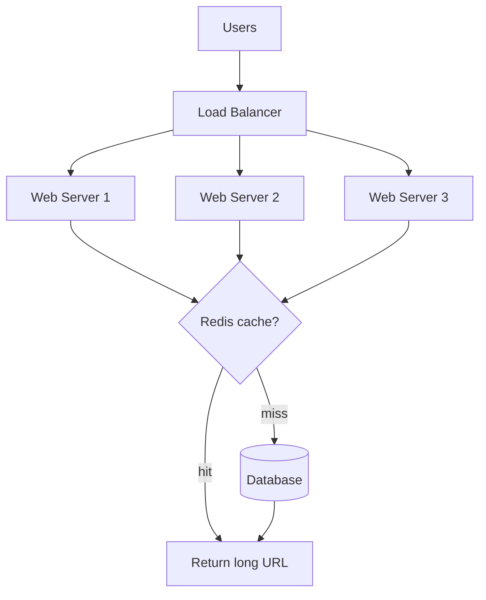

# URL Shortener System Design (bit.ly)
> **Interview Ready** | 45-minute format

## Problem Statement

Design a URL shortening service like bit.ly or TinyURL that:
- Converts long URLs to short URLs
- Redirects short URLs to original URLs
- Tracks click analytics
- Custom short URLs (optional)

**Example:**
```
Long URL: https://www.example.com/blog/2024/01/15/how-to-design-systems?utm_source=twitter&utm_campaign=promo
Short URL: https://bit.ly/3xK9mPq
```

---

## 1️⃣ Requirements Clarification

### Functional Requirements:

1. **URL Shortening**
   - Given long URL → Generate unique short URL
   - Custom aliases (e.g., bit.ly/aws-summit)

2. **URL Redirection**
   - Access short URL → Redirect to original URL
   - 301 (permanent) or 302 (temporary) redirect

3. **Analytics**
   - Track clicks, geographic location, referrer

4. **Expiration**
   - URLs expire after X days (configurable)

### Non-Functional Requirements:
- **Scale:** 100M URLs shortened/month, 10B redirects/month
- **Availability:** 99.99% uptime
- **Latency:** <10ms for redirection
- **Read-heavy:** Read:Write = 100:1 (10B reads, 100M writes)

### Out of Scope:
- User accounts
- QR code generation
- Link management dashboard

---

## 2️⃣ Capacity Estimation

```
Write (URL shortening):
- 100M URLs/month
- 100M / (30 × 24 × 3600) = 38 URLs/sec
- Peak: 38 × 3 = 115 URLs/sec

Read (URL redirection):
- 10B redirects/month
- 10B / (30 × 24 × 3600) = 3,850 redirects/sec
- Peak: 3,850 × 3 = 11,500 redirects/sec

Storage:
- Per URL: Original URL (200 bytes) + Short code (7 bytes) + Metadata (50 bytes) = 257 bytes
- 100M URLs/month × 257 bytes = 25.7 GB/month
- 5 years: 25.7 GB × 12 × 5 = 1.5 TB

Short URL length:
- Character set: [a-z, A-Z, 0-9] = 62 characters (base62)
- 6 characters:  62^6 = 56B unique URLs (enough)
- 7 characters: 62^7 = 3.5T unique URLs (plenty)
```

---

## 3️⃣ API Design

```text
# 1. Shorten URL
POST /v1/shorten
Body: {
  long_url: "https://www.example.com/very/long/url?param=value",
  custom_alias: "my-link",   # optional
  expiration_days: 30        # optional
}

Response: {
  short_url: "https://bit.ly/3xK9mPq",
  long_url: "https://www.example.com/very/long/url?param=value",
  created_at: "2024-01-15T12:00:00Z",
  expires_at: "2024-02-14T12:00:00Z"
}

# 2. Redirect (handled by web server, not API)
GET /{short_code}
→ 301/302 Redirect to long_url

# 3. Get Analytics (optional)
GET /v1/analytics/{short_code}

Response: {
  short_code: "3xK9mPq",
  total_clicks: 15000,
  clicks_last_24h: 500,
  top_countries: ["US", "IN", "GB"],
  top_referrers: ["twitter.com", "facebook.com"]
}
```

---

## 4️⃣ Database Design

### PostgreSQL (Primary Storage)

```sql
-- URLs table
CREATE TABLE urls (
  id BIGSERIAL PRIMARY KEY,
  short_code VARCHAR(10) UNIQUE NOT NULL,
  long_url TEXT NOT NULL,
  created_at TIMESTAMP DEFAULT NOW(),
  expires_at TIMESTAMP,
  clicks BIGINT DEFAULT 0
);

CREATE INDEX idx_urls_short_code ON urls(short_code);
CREATE INDEX idx_urls_expires_at ON urls(expires_at);

-- Analytics (optional)
CREATE TABLE clicks (
  id BIGSERIAL PRIMARY KEY,
  short_code VARCHAR(10) NOT NULL,
  clicked_at TIMESTAMP DEFAULT NOW(),
  ip_address VARCHAR(45),
  user_agent TEXT,
  referrer TEXT,
  country VARCHAR(2)
);

CREATE INDEX idx_clicks_short_code ON clicks(short_code);
CREATE INDEX idx_clicks_clicked_at ON clicks(clicked_at);
```

### Redis (Caching)

```text
# URL mapping cache (hot URLs)
Key: url:{short_code}
Value: long_url
TTL: 1 hour

# Counter for click tracking
Key: clicks:{short_code}
Type: Counter
Value: 15000
TTL: None
```

---

## 5️⃣ High-Level Design



<details class="example" markdown>
<summary>ASCII version (same diagram)</summary>

```
┌──────────────┐
│    Users     │
└──────┬───────┘
       │
       ▼
┌──────────────────────────────────────┐
│   Load Balancer (NGINX)              │
└──────┬───────────────────────────────┘
       │
   ┌───┴──────┬─────────┐
   ▼          ▼         ▼
┌────────┐ ┌────────┐ ┌────────┐
│ Web    │ │ Web    │ │ Web    │  (Stateless)
│Server 1│ │Server 2│ │Server 3│
└───┬────┘ └───┬────┘ └───┬────┘
    │          │         │
    └──────────┴─────────┘
               │
               ▼
        ┌──────────────┐
        │     Redis    │  (Cache hot URLs)
        │   (Cache)    │
        └──────┬───────┘
               │ Cache miss
               ▼
        ┌──────────────┐
        │  PostgreSQL  │  (Persistent storage)
        │  (Primary DB)│
        └──────────────┘
```

</details>

**Data Flow (Redirection):**
1. User clicks short URL → Load Balancer → Web Server
2. Web Server checks Redis cache (Key: `url:{short_code}`)
3. If cache hit → Redirect to long URL (99% case)
4. If cache miss → Fetch from PostgreSQL → Cache in Redis → Redirect

**Data Flow (Shortening):**
1. User submits long URL → Web Server
2. Generate unique short code (base62 encoding)
3. Store in PostgreSQL
4. Cache in Redis (for future redirects)
5. Return short URL

---

## 6️⃣ Low-Level Design

### Class Diagram

```
┌──────────────────────┐
│  URLService          │
├──────────────────────┤
│ + shortenURL()       │
│ + getOriginalURL()   │
└──────┬───────────────┘
       │ uses
       ▼
┌──────────────────────┐
│ ShortCodeGenerator   │
├──────────────────────┤
│ + generateCode()     │
│ + base62Encode()     │
└──────────────────────┘
```

### Sequence Diagram (Redirection)

```
User  WebServer  Redis  PostgreSQL
 │        │         │        │
 │─GET───>│         │        │
 │ /3xK9mPq         │        │
 │        │         │        │
 │        │─Get────>│        │
 │        │ (cache) │        │
 │        │<────────│        │
 │        │  hit    │        │
 │        │         │        │
 │<───────│         │        │
 │ 301 Redirect     │        │
```

---

## 7️⃣ Deep Dives

### Deep Dive 1: Generating Short Code

**Challenge:** Generate unique 7-character short code for each URL

**Approach 1: Random Generation + Collision Check**

```text
FUNCTION generateCode():
    chars = "abcdefghijklmnopqrstuvwxyzABCDEFGHIJKLMNOPQRSTUVWXYZ0123456789"

    LOOP forever:
        # Generate random 7-character code
        code = ""
        FOR i FROM 0 TO 6:
            code = code + chars[random integer in 0..61]

        # Check if code already exists
        exists = query database "SELECT 1 FROM urls WHERE short_code = code"

        IF NOT exists:
            RETURN code
        # If collision, retry (very rare with 62^7 space)
END FUNCTION
```

**Trade-offs:**
- ✅ Simple implementation
- ✅ Uniform distribution
- ❌ Potential collisions (requires retry)
- ❌ DB query for each check (can use Redis SETNX for faster check)

**Approach 2: Counter-based (Base62 Encoding)**

```text
FUNCTION generateCode():
    # 1. Get next counter value from Redis (atomic)
    counter = atomic increment of "url:counter" in Redis

    # 2. Encode counter in base62
    RETURN base62Encode(counter)
END FUNCTION

FUNCTION base62Encode(num):
    chars = "abcdefghijklmnopqrstuvwxyzABCDEFGHIJKLMNOPQRSTUVWXYZ0123456789"
    result = ""

    WHILE num > 0:
        result = chars[num MOD 62] + result
        num = floor(num / 62)

    RETURN left-pad result with 'a' to 7 characters
END FUNCTION

FUNCTION base62Decode(code):
    chars = "abcdefghijklmnopqrstuvwxyzABCDEFGHIJKLMNOPQRSTUVWXYZ0123456789"
    num = 0

    FOR EACH character c IN code:
        num = num * 62 + indexOf(c IN chars)

    RETURN num
END FUNCTION

# Example:
# Counter = 1      → Short code = "aaaaaab"
# Counter = 62     → Short code = "aaaaaBA"
# Counter = 100000 → Short code = "aaaBwq"
```

**Trade-offs:**
- ✅ Guaranteed uniqueness (no collisions)
- ✅ Fast (no DB lookup)
- ❌ Predictable (users can guess next URL)
- ❌ Single counter is bottleneck (mitigate: use multiple counter ranges)

**Best Approach: Counter + Salt (Hash)**

```text
FUNCTION generateCode():
    counter = atomic increment of "url:counter" in Redis

    # Add randomness to make it unpredictable
    hash = md5(counter + SALT)
    shortHash = first 7 characters of hash

    # Encode in base62
    RETURN base62Encode(parse shortHash as hexadecimal integer)
END FUNCTION
```

**Trade-offs:**
- ✅ Unique
- ✅ Unpredictable
- ✅ Fast
- ✅ No collisions

---

### Deep Dive 2: Handling High Read Traffic (Caching Strategy)

**Challenge:** Serve 11,500 redirects/sec with low latency (<10ms)

**Solution: Multi-layer Caching**

```text
FUNCTION getOriginalURL(shortCode):
    # Layer 1: In-memory cache (application level)
    IF localCache contains shortCode:
        RETURN localCache[shortCode]

    # Layer 2: Redis cache (distributed)
    cachedURL = get "url:{shortCode}" from Redis
    IF cachedURL exists:
        # Update local cache
        localCache[shortCode] = cachedURL
        RETURN cachedURL

    # Layer 3: Database (cache miss)
    result = query database "SELECT long_url FROM urls WHERE short_code = shortCode"

    IF result exists:
        longURL = result.long_url

        # Cache in Redis (1 hour TTL)
        set "url:{shortCode}" = longURL in Redis with TTL 3600 seconds

        # Cache locally
        localCache[shortCode] = longURL

        RETURN longURL

    RETURN null   # URL not found
END FUNCTION
```

**Caching Strategy:**
- **Hot URLs (top 20%):** Cached in-memory (LRU cache, 10K entries)
- **Warm URLs (next 60%):** Cached in Redis (1 hour TTL)
- **Cold URLs (bottom 20%):** Fetched from PostgreSQL

**Cache Hit Ratio:**
- In-memory: 80% hit rate
- Redis: 15% hit rate
- Database: 5% hit rate

**Result:**
- 80% of requests served in <1ms (in-memory)
- 15% of requests served in <5ms (Redis)
- 5% of requests served in <20ms (PostgreSQL)

---

### Deep Dive 3: Analytics at Scale

**Challenge:** Track 11,500 clicks/sec without slowing down redirects

**Solution: Async Event Processing**

```text
FUNCTION redirect(shortCode, request):
    # 1. Get original URL (fast, cached)
    longURL = call getOriginalURL(shortCode)

    IF longURL is null:
        RETURN 404

    # 2. Fire-and-forget analytics event (async, non-blocking)
    START trackClick(shortCode, request) in background
        ON error: log "Analytics tracking failed" but do NOT block redirect

    # 3. Redirect immediately (don't wait for analytics)
    RETURN redirect(301, longURL)
END FUNCTION

FUNCTION trackClick(shortCode, request):
    # Send event to Kafka (buffered, high throughput)
    send to Kafka topic "url-clicks":
        key   = shortCode
        value = {
            short_code: shortCode,
            ip:         request.ip,
            user_agent: request.header "user-agent",
            referrer:   request.header "referer",
            timestamp:  current time
        }
END FUNCTION

# Kafka consumer (separate service)
FUNCTION processClickEvent(event):
    # 1. Increment counter in Redis (fast)
    atomic increment of "clicks:{event.short_code}" in Redis

    # 2. Batch insert to PostgreSQL (every 10 seconds)
    append event to clickBuffer

    IF size of clickBuffer >= 1000:
        call flushToDatabase()
END FUNCTION

FUNCTION flushToDatabase():
    # Batch insert 1000 rows at once
    batch insert clickBuffer into "clicks" table
    clickBuffer = empty list
END FUNCTION
```

**Trade-offs:**
- ✅ Redirection fast (not blocked by analytics)
- ✅ Kafka handles high throughput (11,500 events/sec)
- ✅ Batch inserts reduce DB load
- ❌ Analytics not real-time (few seconds delay)

---

## 8️⃣ Bottlenecks & Optimizations

### Bottlenecks:

1. **Database Writes** → Batch inserts for analytics
2. **Single Counter** → Use range-based counters (Server 1: 1-1B, Server 2: 1B-2B)
3. **Cache Invalidation** → Use TTL, evict expired URLs

### Optimizations:

**1. Geographical Distribution:**
```
Deploy servers in multiple regions (US, EU, Asia)
Use GeoDNS to route to nearest server
Replicate cache and database
```

**2. Bloom Filter (Check Existence):**
```
Before checking DB, use Bloom filter
Reduces DB queries for non-existent URLs by 99%
```

**3. Popular URL Preloading:**
```
Pre-warm cache with trending URLs
Predictive caching based on patterns
```

---

## 9️⃣ Interview Tips

### What to Focus on (45-min):

1. **Clarify requirements** (5 min)
   - Scale (read:write ratio)
   - Custom aliases?
   - Analytics?

2. **High-level design** (10 min)
   - PostgreSQL for storage
   - Redis for caching
   - Base62 encoding

3. **Deep dive 1: Short code generation** (10 min)
   - Counter-based (base62)
   - Handle collisions
   - Distributed counter

4. **Deep dive 2: Caching strategy** (10 min)
   - Multi-layer cache (in-memory + Redis)
   - Cache hit ratio

5. **Discuss analytics** (5 min)
   - Async processing (Kafka)
   - Batch writes

6. **Bottlenecks** (5 min)

### Common Follow-ups:

**Q: How do you handle custom aliases (e.g., bit.ly/aws-summit)?**
A: Check if alias is available, store in same table with `custom: true` flag

**Q: How do you delete expired URLs?**
A: Background job runs daily, deletes URLs where `expires_at < NOW()`

**Q: How do you prevent abuse (spam URLs)?**
A: Rate limiting (Redis), URL blacklist, require CAPTCHA for anonymous users

**Q: How do you handle URL encoding (special characters)?**
A: Use URL encoding/decoding (percent-encoding)

**Q: 301 vs 302 redirect?**
A: 
- 301 (Permanent): Browser caches, good for SEO, can't track clicks after first visit
- 302 (Temporary): Not cached, can track all clicks (better for analytics)

---

## Summary

**Key Decisions:**
1. ✅ **Base62 encoding** (counter-based, 7 characters)
2. ✅ **Redis caching** (99% cache hit rate)
3. ✅ **Async analytics** (Kafka + batch inserts)
4. ✅ **Multi-layer caching** (in-memory + Redis + PostgreSQL)

**Tech Stack:**
- Backend: Go/Node.js (low latency)
- Database: PostgreSQL (primary), Redis (cache)
- Queue: Kafka (analytics events)
- Load Balancer: NGINX
