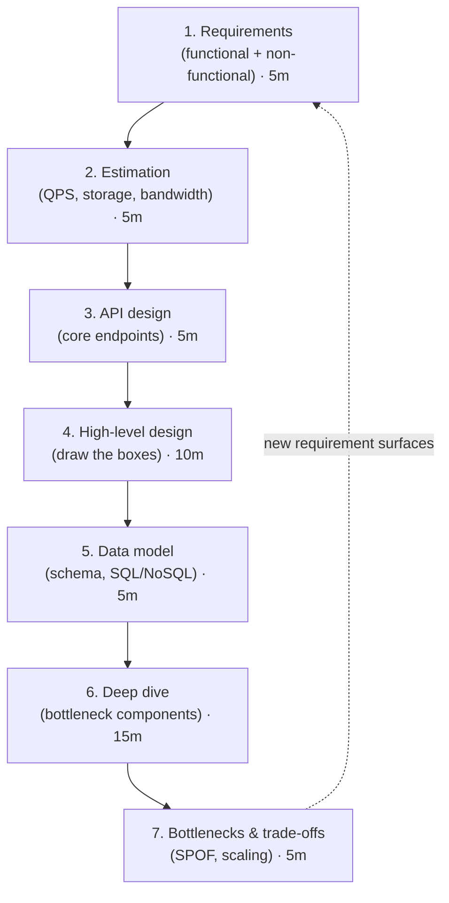
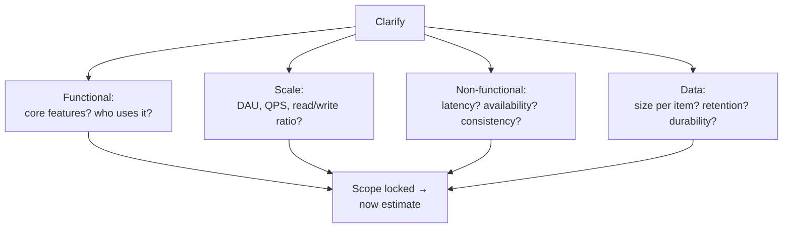
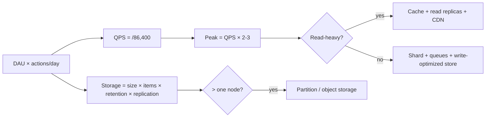
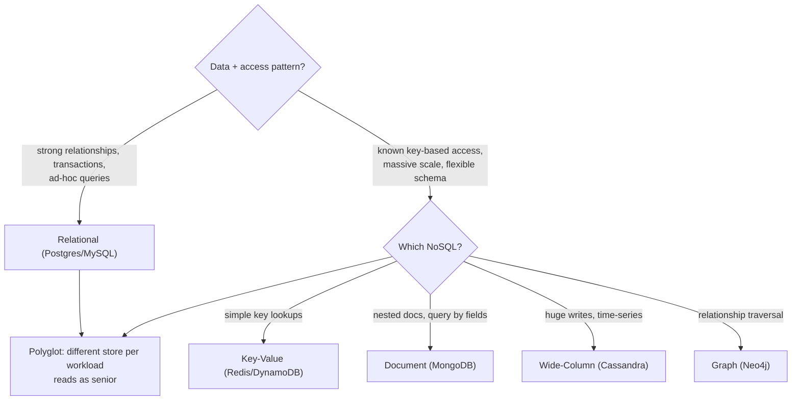
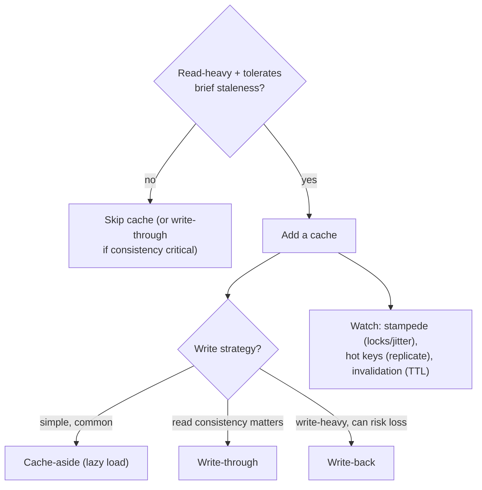
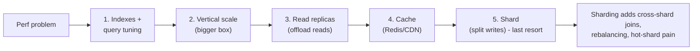
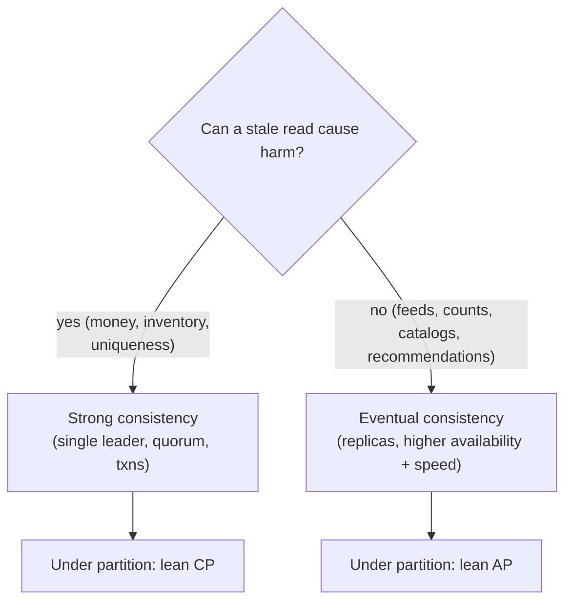

# 🧭 System Design Mental Models - How to *Approach*

System design interviews feel open-ended, but strong candidates run the **same repeatable process**
every time and make decisions from a small set of trade-offs. This page is the thinking layer:
the framework as a flowchart, plus decision aids for the choices that come up in every design.

Pair it with the [System Design Guide](SystemDesignGuide.md) (the detailed framework + numbers) and
the [real designs](designs/url-shortener.md).

!!! tip "The mindset that scores"
    Don't rush to boxes-and-arrows. **Clarify → estimate → then design**, and narrate your
    trade-offs out loud. Interviewers grade your *reasoning*, not a memorized architecture.

---

## 1. The framework - run this every time

The 7-step loop (mirrors the [guide](SystemDesignGuide.md); timings assume a 45-min round):

The dotted arrow matters: if a deep-dive reveals a missed requirement, loop back - don't patch
around it.

---

## 2. Step 1 - the clarifying questions to always ask

Before anything, pin down scope. These questions shape the entire design:

The **read/write ratio** and **consistency need** are the two answers that most change the design -
ask them early.

---

## 3. Estimation - constraints drive the architecture

Rough numbers decide whether you need caching, sharding, or a CDN - *before* you draw anything.

Full method + the latency numbers to memorize:
[Latency & Estimation](../Fundamentals/latency-numbers-and-estimation.md) ·
[System Design Guide](SystemDesignGuide.md).

---

## 4. Decision: SQL vs NoSQL

Detail: [SQL vs NoSQL & Scaling](../Databases/sql-vs-nosql-and-scaling.md) ·
[Database Internals](../Fundamentals/databases-internals.md).

---

## 5. Decision: do I need a cache, and which strategy?

Detail: [Caching component](components/caching.md) · [Caching Q&A](../QA-Bank/qa-caching.md).

---

## 6. Decision: how do I scale it?

Do the cheap thing first - don't jump to sharding.

Detail: [Database Sharding](components/database-sharding.md) ·
[Load Balancer](components/load-balancer.md).

---

## 7. Decision: consistency - strong or eventual?

Choose **per data type**, not globally.

Detail: [Distributed Systems (CAP/PACELC)](DistributedSystemsConcepts.md) ·
[SD Concepts Q&A](../QA-Bank/qa-system-design-concepts.md).

---

## 8. Worked walkthroughs - the framework in action

!!! example "Design a URL shortener"
    - **Requirements:** shorten a long URL, redirect fast; read-heavy (redirects ≫ creates).
    - **Estimation:** redirects dominate → **read-heavy** → cache + CDN are central.
    - **API:** `POST /shorten`, `GET /{code}`.
    - **HLD:** LB → stateless app → cache (hot URLs) → DB on miss.
    - **Data model:** `code → long_url`; simple key access → could be KV, but a relational DB is fine
      at this scale.
    - **Deep dive:** how to generate the short code (base62 of an ID, or a
      [unique-ID generator](designs/unique-id-generator.md)); cache to keep redirects <10ms.
    - **Bottlenecks:** the code generator and the cache are the hot spots. Full design:
      [URL Shortener](designs/url-shortener.md).

!!! example "Design a news feed (Twitter timeline)"
    - **Requirements:** show recent posts from people you follow; read-heavy; some users have
      millions of followers.
    - **Estimation:** read-heavy at huge fan-out → precompute vs compute-on-read is the core tension.
    - **HLD:** the key decision is **fan-out on write vs on read** - push to followers' feeds at post
      time (fast reads, expensive for celebrities) vs merge at read time (cheap writes, slower reads).
    - **Deep dive:** a **hybrid** - precompute for most users, read-time merge for high-follower
      accounts. That single trade-off is what the interview is testing.
    - Full design: [Twitter / News Feed](designs/twitter.md).

!!! note "The meta-lesson"
    Both walkthroughs front-load **requirements + estimation**, and the whole design pivots on **one
    or two key trade-offs** (code generation + caching; fan-out write vs read). Find that pivot and
    reason about it out loud - that's the signal of a strong candidate.

---

## How to practice with this

1. Pick any [real design](designs/url-shortener.md); cover the solution and run the
   [7-step framework](#1-the-framework-run-this-every-time) yourself first.
2. At each decision, consult the matching flowchart above (SQL/NoSQL, cache, scale, consistency).
3. Force yourself to **state the read/write ratio and consistency need early** - they drive
   everything else.
4. Name the **one or two pivotal trade-offs** for the problem; that's what interviewers probe.

## Related

- Detailed framework + numbers → [System Design Guide](SystemDesignGuide.md)
- Real designs → [designs/](designs/url-shortener.md)
- Components → [Caching](components/caching.md) · [sharding](components/database-sharding.md) · [load balancer](components/load-balancer.md)
- Distributed concepts → [Distributed Systems](DistributedSystemsConcepts.md)
- DSA thinking layer → [DSA Mental Models](../DSA/mental-models.md)
